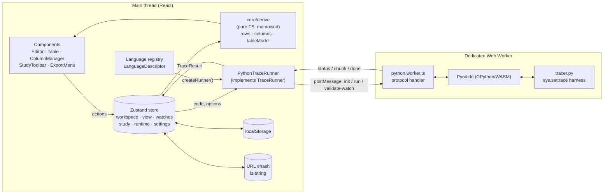
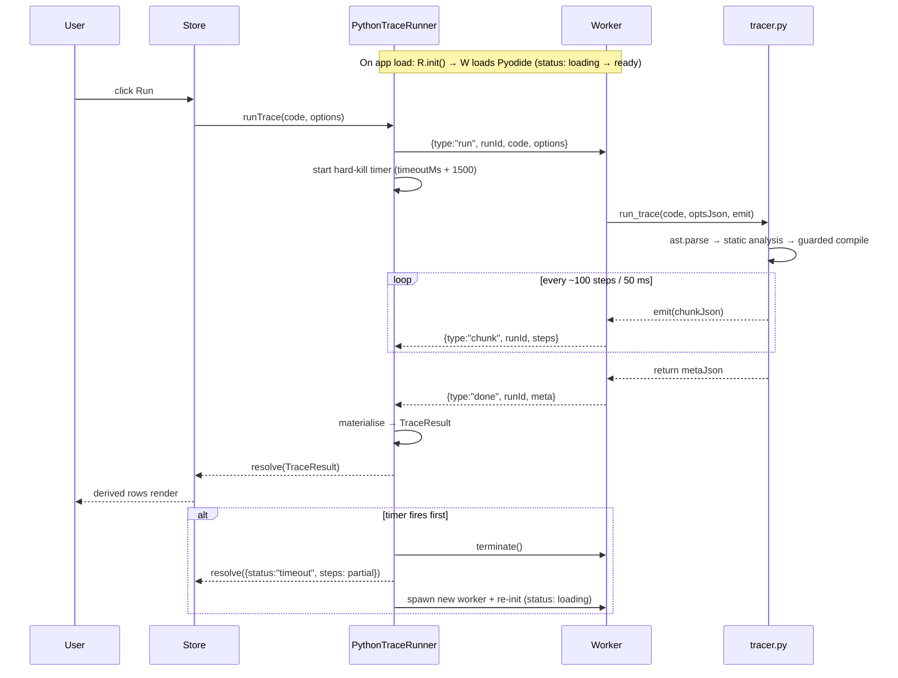

# Trace Table Studio — Architecture & Implementation Plan

> Client-side Python trace-table generator with Study/Quiz mode and multi-format export.
> Stack: React + TypeScript + Vite · Tailwind CSS v4 · CodeMirror 6 · Pyodide in a Web Worker · Zustand · lz-string · html-to-image.

This document is the blueprint to build from. Sections 3–6 are normative (contracts and algorithms), section 8 lists edge cases, section 9 is the build order.
Design claims about `sys.settrace` behaviour were validated with a throwaway prototype on CPython **3.12.15 and 3.13.17** (the versions bundled by Pyodide 0.27.x / 0.28.x). Findings from that prototype are called out with **[verified]**.

---

## 0. Key design decisions (read first)

| # | Decision | Why |
|---|----------|-----|
| D1 | **The worker always records the full, every-line trace.** Granularity, column visibility, "exam blanks" display, and study masking are pure TypeScript projections on the main thread. | Toggling Compact ↔ Every-line, hiding a column, or starting Study Mode is instant and never re-executes code. Only *code, stdin, watches, seed, limits* trigger a re-run. |
| D2 | **Rows record post-state.** A `line` event fires *before* a line runs, so the tracer keeps a "pending line" per frame and finalises it (snapshot + stdout + watches) on the *next* event in that frame. | Trace tables show values *after* each line. **[verified]** this gives correct exam ordering, e.g. in `r = fact(3)` the callee rows appear before the `r = 6` row. |
| D3 | **Language-neutral `Value` model + `TraceStep` contract.** Each language adapter turns its private wire format into the shared types. Everything downstream (table, study, export, share) only knows the shared types. | Adding JS/Java/C++ later is just a new `LanguageDescriptor` + `TraceRunner`. |
| D4 | **Values are serialised to immutable JSON the instant a step is finalised.** No live references cross the boundary. | Solves mutable snapshot aliasing by construction (no `deepcopy`, no PyProxy leaks). |
| D5 | **Python → JS transport is JSON strings, streamed in chunks** (every ~100 steps / 50 ms) via an injected `emit` callback. | Avoids PyProxy lifetime management. Partial traces survive a hard `worker.terminate()`. |
| D6 | **Layered safety:** step limit + soft deadline in the tracer → AST guard against swallowing → `SharedArrayBuffer` interrupt (if cross-origin isolated) → hard `worker.terminate()` + respawn. | `sys.settrace` alone can't stop code blocked in C (`sum(range(10**10))`), and **[verified]** a bare `except:` swallows the abort exception, after which CPython disables tracing permanently. |
| D7 | **`input()` uses pre-supplied stdin. When it runs dry, the run ends with `awaiting-input` and the UI asks, appends, and re-runs deterministically (seeded `random`).** | No blocking worker, no COOP/COEP requirement. Runs are ~milliseconds, so re-running is invisible. |
| D8 | **`runTrace` never rejects for user-code problems.** Syntax errors, exceptions, limits and timeouts all resolve with a `status`. It rejects only if the runtime itself is broken. | One code path in the UI. Partial traces are always renderable. |

---

## 1. Architecture & data flow



### Run sequence



---

## 2. Project structure

```
trace_table/
├─ index.html
├─ package.json · vite.config.ts · tsconfig.json · eslint.config.js
├─ public/
│   └─ _headers                      # COOP/COEP for Netlify/Cloudflare (optional, enables SAB interrupt)
├─ src/
│   ├─ main.tsx · App.tsx
│   ├─ core/                         # framework-free, language-agnostic, 100% unit-tested
│   │   ├─ types.ts                  # Value, TraceStep, TraceResult, TraceOptions, Watch*
│   │   ├─ runner.ts                 # TraceRunner, RunnerStatus, RunnerCapabilities
│   │   ├─ language.ts               # LanguageDescriptor, Preset
│   │   ├─ derive/
│   │   │   ├─ columns.ts            # discover ColumnDefs from TraceResult
│   │   │   ├─ rows.ts               # granularity + visibility → TraceRow[]
│   │   │   └─ tableModel.ts         # TraceRow[] → {headers, cells: string[][]} for exporters
│   │   ├─ study/
│   │   │   ├─ rng.ts                # mulberry32 seeded PRNG
│   │   │   ├─ mask.ts               # mask selection
│   │   │   └─ grade.ts              # answer comparison (uses descriptor.parseAnswer)
│   │   ├─ export/ markdown.ts · csv.ts · latex.ts · json.ts · download.ts
│   │   └─ share/ urlState.ts        # encode/decode + schema versioning
│   ├─ languages/
│   │   ├─ registry.ts               # { python: pythonDescriptor }
│   │   └─ python/
│   │       ├─ descriptor.ts
│   │       ├─ PythonTraceRunner.ts  # worker lifecycle, timers, wire → TraceStep materialisation
│   │       ├─ protocol.ts           # message unions (shared by worker + adapter)
│   │       ├─ python.worker.ts
│   │       ├─ tracer.py             # imported via `?raw`
│   │       ├─ literal.ts            # Python literal parser + formatter (grading & display)
│   │       └─ presets.ts
│   ├─ store/  index.ts · workspaceSlice.ts · runtimeSlice.ts · viewSlice.ts · watchSlice.ts · studySlice.ts · settingsSlice.ts
│   ├─ components/
│   │   ├─ layout/   AppShell · Toolbar · RuntimeStatusBadge · ThemeToggle
│   │   ├─ editor/   CodeEditor · traceHighlight.ts (StateField/Effect) · InputsPanel · PresetPicker
│   │   ├─ table/    TraceTable · TraceCell · ColumnManager · WatchPanel · ErrorBanner
│   │   ├─ study/    StudyToolbar · StudyCell · ScoreSummary
│   │   └─ export/   ExportMenu · ExportTable (static, non-virtualised render for PNG/print)
│   └─ styles/ index.css (Tailwind + @media print)
└─ tests/
    ├─ tracer/  test_tracer.py · conftest.py   # pytest on CPython 3.12 & 3.13 (tracer.py has no Pyodide deps)
    ├─ unit/    *.test.ts                      # vitest: derive, grade, literal, exporters, urlState
    ├─ fixtures/ presets/*.trace.json          # recorded TraceResults (golden files)
    └─ e2e/     *.spec.ts                      # Playwright against real Pyodide
```

`tracer.py` deliberately imports nothing from `js`/`pyodide`. The worker injects the `emit` callback. That lets the whole tracer be tested with plain `pytest` (`uv run --python 3.12 pytest tests/tracer`), which is far faster than testing through a browser.

---

## 3. Core TypeScript interfaces (`src/core/types.ts`, `runner.ts`, `language.ts`)

```ts
// ───────────── Values (language-neutral, immutable, JSON-safe) ─────────────
export type Value =
  | { k: 'none' }
  | { k: 'bool'; v: boolean }
  | { k: 'int'; v: string }                       // string: arbitrary precision, no bigint JSON issues
  | { k: 'float'; v: string }                     // repr(): '0.1', 'inf', 'nan', '3.0'
  | { k: 'str'; v: string; truncated?: number }   // truncated = original length if cut
  | { k: 'list' | 'tuple' | 'set' | 'frozenset'; items: Value[]; ref: number; truncated?: number }
  | { k: 'dict'; entries: [Value, Value][]; ref: number; truncated?: number }
  | { k: 'object'; type: string; fields: Record<string, Value>; ref: number }  // instances with __dict__
  | { k: 'cycle'; ref: number }                   // back-reference → rendered like Python's [...]
  | { k: 'opaque'; type: string; repr: string };  // range, generators, anything else (repr, capped)

// `ref` = per-run stable object identity. Two variables with the same ref alias the same object
// (UI can badge "a ≡ b"). It is NOT id(): ids are re-mapped to small ints so they're stable across runs.

// ───────────── Frames & steps ─────────────
export interface FrameInfo {
  id: number;            // unique per call within a run (0 = module)
  name: string;          // '<module>', 'fact', 'Stack.push'
  depth: number;         // 0 = module
  callLine?: number;     // caller's line that made this call
  argsLabel?: string;    // 'fact(n=3)' — for the call-stack column
}

export interface VarRef { frameId: number; name: string }

export interface ScopeSnapshot {
  frame: FrameInfo;
  vars: Record<string, Value>;   // full state of that frame after this step (structurally shared between steps)
}

export type StepKind = 'call' | 'line' | 'return' | 'exception';

export interface TraceStep {
  stepIndex: number;
  kind: StepKind;
  lineNumber: number;
  lineSource: string;
  frame: FrameInfo;                  // active frame
  callStack: FrameInfo[];            // user frames only, outermost → innermost
  scopes: ScopeSnapshot[];           // every live user frame, same order as callStack
  writes: VarRef[];                  // bound or mutated by this step (value change ∪ static assignment)
  deletes: VarRef[];                 // del x / name leaves scope
  stdoutDelta: string;               // printed during this step (includes echoed input())
  returnValue?: Value;               // only when kind === 'return' and the return is explicit
  exception?: { type: string; message: string; caught: boolean };
  branch?: boolean;                  // if/elif/while/for header: was the body entered?
  watches: Record<string, WatchResult>;
}

// ───────────── Result ─────────────
export type TraceStatus =
  | 'ok' | 'syntax-error' | 'runtime-error' | 'step-limit' | 'timeout'
  | 'awaiting-input' | 'cancelled' | 'internal-error';

export interface TraceError {
  kind: TraceStatus;
  type?: string;                     // 'ZeroDivisionError'
  message: string;                   // user-facing, already friendly
  line?: number; column?: number; endLine?: number; endColumn?: number;
  traceback?: { line: number; functionName: string }[];   // user frames only
}

export interface VariableMeta {
  columnId: ColumnId;                // `${scopeName}:${name}` e.g. 'fact:n', '<module>:total'
  scopeName: string;
  name: string;
  firstStep: number;                 // drives default column order (order of first appearance)
  ephemeral: boolean;                // comprehension targets etc. → hidden by default
}

export interface TraceResult {
  runId: string;
  language: LanguageId;
  status: TraceStatus;
  steps: TraceStep[];
  variables: VariableMeta[];
  functions: string[];               // function scopes seen, for column grouping
  stdout: string;                    // full output
  error?: TraceError;
  inputRequest?: { prompt: string; consumedCount: number };
  stats: { stepsExecuted: number; durationMs: number; truncated: boolean };
  executionKey: string;              // hash(language, code, stdin, watches, seed, limits) — keys study sessions
}

// ───────────── Options & watches ─────────────
export interface WatchExpression {
  id: string;                        // nanoid, stable → column id `watch:${id}`
  expr: string;                      // 'arr[i]', 'len(items)', 'i < n'
  label?: string;
  scope: { kind: 'current' } | { kind: 'function'; name: string } | { kind: 'module' };
  enabled: boolean;
}

export type WatchResult =
  | { ok: true; value: Value }
  | { ok: false; reason: 'not-in-scope' | 'error' | 'rejected'; message: string };

export interface TraceOptions {
  maxSteps: number;                  // raw line events (default 1000, UI range 100–10 000)
  timeoutMs: number;                 // default 3000
  maxCallDepth: number;              // default 100 (WASM stack is smaller than native)
  stdin: string[];                   // one entry per input() call
  watches: WatchExpression[];
  randomSeed: number;                // makes `random` deterministic → re-runs & study sessions reproducible
  valueLimits: { maxItems: number; maxDepth: number; maxStringLength: number }; // 50 / 4 / 200
  showCallables: boolean;            // include functions/classes/modules as variables (default false)
  signal?: AbortSignal;
  onProgress?: (p: { stepsExecuted: number }) => void;
}
// NB: granularity, column visibility, display style are NOT TraceOptions (decision D1).

// ───────────── Runner contract (src/core/runner.ts) ─────────────
export type RunnerStatus =
  | { state: 'uninitialised' }
  | { state: 'loading'; message: string; progress?: number }   // 'Downloading Python runtime… 62%'
  | { state: 'ready' }
  | { state: 'running'; stepsExecuted: number }
  | { state: 'failed'; message: string };                     // runtime itself unusable

export interface RunnerCapabilities {
  watchExpressions: boolean;
  stdin: boolean;
  inputMode: 'rerun' | 'blocking' | 'none';
  hardInterrupt: boolean;            // true when SAB interrupt is available (no reload on cancel)
  branchInfo: boolean;
  returnValues: boolean;
}

export interface TraceRunner {
  readonly language: LanguageId;
  readonly capabilities: RunnerCapabilities;
  getStatus(): RunnerStatus;
  onStatus(listener: (s: RunnerStatus) => void): () => void;   // returns unsubscribe
  init(): Promise<void>;                                        // idempotent
  /** Resolves with a TraceResult for ALL user-code outcomes; rejects only on runtime failure. */
  runTrace(code: string, options: TraceOptions): Promise<TraceResult>;
  validateWatch?(expr: string): Promise<{ ok: true } | { ok: false; message: string }>;
  cancel(): void;
  dispose(): void;
}

// ───────────── Language plug-in (src/core/language.ts) ─────────────
export type LanguageId = 'python' | 'javascript' | 'java' | 'cpp' | 'csharp';

export interface LanguageDescriptor {
  id: LanguageId;
  label: string;
  editorExtension: () => Promise<import('@codemirror/state').Extension>;  // lazy
  createRunner: () => TraceRunner;
  presets: Preset[];
  formatValue(v: Value): string;                    // Python: "[1, 2]", "'hi'", "True", "None"
  parseAnswer(text: string): ParsedAnswer;          // Study Mode: user text → Value | error
  defaultOptions?: Partial<TraceOptions>;
}

export type ParsedAnswer = { ok: true; value: Value } | { ok: false; raw: string };
export interface Preset { id: string; title: string; description: string; code: string; stdin?: string[]; suggestedWatches?: string[] }

// ───────────── Derived view model (src/core/derive) ─────────────
export type ColumnId = string;   // 'line' | 'output' | 'return' | 'stack' | `${scope}:${name}` | `watch:${id}`
export interface ColumnDef { id: ColumnId; header: string; group?: string; kind: 'meta' | 'var' | 'watch' }
export interface Cell { value?: Value; display: string; written: boolean; stale?: boolean }
export interface TraceRow { rowIndex: number; stepIndices: number[]; lineNumber: number; depth: number; cells: Record<ColumnId, Cell> }
```

### Messaging protocol (`src/languages/python/protocol.ts`)

```ts
// Main → Worker
export type ToWorker =
  | { type: 'init'; indexURL: string; interruptBuffer?: SharedArrayBuffer }
  | { type: 'run'; runId: string; code: string; options: WireOptions }       // WireOptions = TraceOptions minus signal/onProgress
  | { type: 'validate-watch'; requestId: string; expr: string };

// Worker → Main
export type FromWorker =
  | { type: 'status'; status: 'loading' | 'ready'; message?: string; progress?: number }
  | { type: 'chunk'; runId: string; steps: WireStep[]; frames: WireFrame[] }  // streamed
  | { type: 'done'; runId: string; meta: WireMeta }                           // status, error, stdout, stats, variables
  | { type: 'watch-validated'; requestId: string; ok: boolean; message?: string }
  | { type: 'fatal'; message: string };                                       // Pyodide failed to load/crashed

// Compact wire step (private to the Python adapter; materialised into TraceStep by the adapter)
export interface WireStep {
  i: number; k: 'c' | 'l' | 'r' | 'x';    // call/line/return/exception
  ln: number; f: number; stk: number[];   // line, frame id, stack of frame ids
  w?: [number, string, Value][];          // writes: frameId, name, new value (delta encoding)
  d?: [number, string][];                 // deletes
  o?: string; r?: Value; x?: { t: string; m: string; c: boolean };
  b?: boolean; wt?: Record<string, WatchResult>;
}
```

Rules:
- Every message carries `runId`. The adapter ignores chunks/done for any run that isn't current, so stale results can't overwrite fresh ones.
- One run at a time per runner. A new `runTrace` cancels the in-flight one.
- **Materialisation:** the adapter applies the deltas to a running `Map<frameId, Record<string, Value>>` and emits `TraceStep.scopes` with structural sharing (an unchanged frame reuses the previous object). Memory stays O(changes), but every step still exposes full state.

---

## 4. Python tracer design (`tracer.py`)

### 4.1 Pipeline per run

```
run_trace(code, opts_json, emit) -> meta_json
 1. ast.parse(code)                → SyntaxError? return {status:'syntax-error', line, col, endLine, endCol, msg}
 2. static analysis (StaticInfo)   → per-line facts (see 4.4)
 3. guard transform (4.6)          → AST with abort re-raise in broad except handlers; lines preserved
 4. compile(tree, "<user>", "exec")
 5. fresh sandbox: globals = {"__name__": "__main__", "__builtins__": patched_builtins}
    patched builtins: input → stdin queue; print untouched (stdout is redirected instead)
    random.seed(seed); sys.setrecursionlimit(base + maxCallDepth); import guard (4.8)
 6. sys.stdout = sys.stderr = StepBuffer();  sys.settrace(tracer.global_trace)
 7. exec(code_obj, globals)   inside try/except TraceAbort / Exception / EOFError(input)
 8. finally: sys.settrace(None); restore stdout/stderr/recursionlimit; finalise all pending frames; flush
 9. return meta (status, error, stats, variables meta, full stdout)
```

### 4.2 Tracer skeleton

```python
USER_FILE = "<user>"
TRANSPARENT = {"<genexpr>", "<lambda>", "<listcomp>", "<dictcomp>", "<setcomp>"}

class TraceAbort(BaseException):          # BaseException: `except Exception` in user code can't catch it
    def __init__(self, reason): self.reason = reason     # 'step-limit' | 'timeout' | 'depth-limit'

class Tracer:
    def __init__(self, opts, static, emit):
        self.opts, self.static, self.emit = opts, static, emit
        self.steps, self.raw_count = [], 0
        self.pending = {}          # frame_key -> lineno awaiting finalisation
        self.frame_ids = {}        # id(frame) -> small stable int   (removed on real return)
        self.last = {}             # (fid, name) -> canonical JSON of last emitted value
        self.refs = RefTable()     # id(obj) -> small stable int, holds strong refs for the run (prevents id reuse)
        self.out = StepBuffer()
        self.deadline = time.monotonic() + opts.timeout_ms / 1000
        self.abort_reason = None

    # Installed with sys.settrace; receives only 'call' events.
    def global_trace(self, frame, event, arg):
        if frame.f_code.co_filename != USER_FILE:
            return None                                   # don't trace stdlib/harness frames at all
        if self.abort_reason: raise TraceAbort(self.abort_reason)
        if frame.f_code.co_name in TRANSPARENT:
            return self.transparent_trace                 # counts steps, emits no rows of its own
        self.on_call(frame)                               # emits a 'call' step: params as writes
        return self.local_trace

    def local_trace(self, frame, event, arg):
        if event == "line":
            self.tick()                                   # step limit + deadline (4.5)
            self.finalise(frame, next_line=frame.f_lineno)    # previous line of THIS frame, post-state
            self.pending[self.fid(frame)] = frame.f_lineno
        elif event == "exception":
            self.note_exception(frame, arg)               # attached to the pending line; caught/uncaught resolved later
        elif event == "return":
            self.finalise(frame, next_line=None, returning=arg)
            self.on_frame_exit(frame)
        return self.local_trace
```

A row's state is always **after** its line, because `finalise` runs on the *next* event in that frame (decision D2).

### 4.3 What `finalise` records

1. **Stdout delta:** `self.out.take()` returns and clears everything written since the last finalise. Output printed by a callee is finalised under the callee's own lines first, so it lands on the right row. **[verified]**
2. **Snapshot + diff (delta encoding):**
   - **Active frame:** serialise all visible locals.
   - **Module globals:** serialise all. They're usually few, and a callee can rebind them via `global`.
   - **Other live user frames (callers):** re-serialise **only names bound to mutable objects** (list/dict/set/instances) and closure cells. Immutable bindings in a suspended frame can't change. **[verified]** without this, `bump(nums)` mutating `nums[0]` inside the callee leaves the caller's `nums` column stale until the caller resumes.
   - A per-step memo `id(obj) → Value` means an object reachable from several names is serialised once per step.
   - Compare each canonical JSON string with `self.last[(fid, name)]`. If it differs → `writes`. Names that disappeared → `deletes`.
3. **Static writes:** also add any name in `static.assigns[line]` that exists in the frame. This covers `found = False` re-assigning an unchanged value. Exam tables expect a row there even though nothing changed.
4. **Return value:** on a `return` event, `arg` is the return value. Set `returnValue` only if `line in static.return_lines` (an explicit `return`). Implicit `None` returns stay blank. If the frame is unwinding from an uncaught exception (an `exception` event with no later `line`), set `kind='exception'` instead.
5. **Branch info:** if the finalised line is an `if`/`elif`/`while`/`for` header, `branch = next_line in static.body_range[line]`. The next line is known at finalise time for free.
6. **Watches:** evaluated here against post-state (4.7).
7. **Call rows:** `on_call` emits `kind='call'` at `co_firstlineno` with the parameters as writes and `argsLabel = "fact(n=3)"`. **[verified]** without this, the parameter shows up as "changed" on the first body line, which is wrong for exam tables.

### 4.4 Static analysis (`StaticInfo`, one AST pass)

| Field | Use |
|-------|-----|
| `assigns: dict[line, set[name]]` | Assign / AugAssign / AnnAssign / For target / With-as / walrus / import / def / class names per line |
| `return_lines: set[line]` | Explicit `return` statements |
| `body_range: dict[header_line, (first, last)]` | Branch outcome for if/elif/while/for |
| `ephemeral: set[name]` | Names bound **only** as comprehension targets → `VariableMeta.ephemeral = True` (hidden by default) |
| `source_lines: list[str]` | `lineSource` |

**[verified]** On 3.12+ (PEP 709), list comprehensions are inlined. Their loop variable appears in the enclosing frame's `f_locals` while the comprehension runs, producing one step per iteration on the same line. Marking it ephemeral hides that column by default, and Compact mode then drops those rows.

### 4.5 Limits & aborts

```python
def tick(self):
    self.raw_count += 1
    if self.raw_count > self.opts.max_steps:        self.abort("step-limit")
    if self.raw_count & 63 == 0 and time.monotonic() > self.deadline: self.abort("timeout")
    if len(self.steps) - self.flushed >= 100 or self.flush_timer_due(): self.flush()

def abort(self, reason):
    self.abort_reason = reason                       # sticky: re-raised at every later call event
    raise TraceAbort(reason)
```

- **Step limit counts raw `line` events**, not table rows. Recommended default: **1000**. A 6-element bubble sort is ~150 line events, so a limit of 500 is tight for Every-line mode. Rows are always ≤ steps.
- **Recursion depth:** `on_call` checks `depth > maxCallDepth` → `abort("depth-limit")` with a friendly message. That's well below the point where the WASM stack overflows, which can corrupt the Pyodide instance.
- **Final status** comes from `self.abort_reason` whether or not the exception escaped (see 4.6).

### 4.6 The "swallowed abort" problem and the guard

**[verified on 3.12 & 3.13]** If user code has a bare `except:` (or `except BaseException`) around the line where the tracer raises, the handler catches `TraceAbort`. CPython then **unsets the trace function**, and the program keeps running **untraced** (the test loop ran all 10⁶ iterations).

Mitigations, in order:
1. **AST guard transform.** For every `ExceptHandler` whose `type` is `None`, `BaseException`, or a tuple containing it, insert `__tt_check__()` as the handler's first statement. `__tt_check__` re-raises `TraceAbort` if `abort_reason` is set. `ast.copy_location` keeps line numbers intact. Same for `try/finally` bodies: `finally` code runs, but the abort continues propagating afterwards.
2. **Sticky status:** even if code somehow continues, the result reports `step-limit`/`timeout` with the partial trace.
3. **Hard backstop:** main-thread timer → SAB interrupt (if available) → `worker.terminate()`. The partial trace was already streamed (D5).

### 4.7 Watch expressions

- **Validation (on add/edit, via `validate-watch`):** `ast.parse(expr, mode="eval")`, then an **allowlist** walk:
  - Allowed nodes: `Name`, `Constant`, `Subscript`, `Slice`, `Attribute` (non-dunder), `BinOp`, `UnaryOp`, `BoolOp`, `Compare`, `IfExp`, `Tuple`/`List`/`Set`/`Dict` literals.
  - Allowed `Call` only for safe builtins `{len, abs, min, max, sum, sorted, round, int, float, str, bool, ord, chr, isinstance, any, all, list, tuple}` and pure methods `{count, index, get, keys, values, items, upper, lower, strip, find, startswith, endswith, isdigit, isalpha, split, join}`.
  - Rejected: lambdas, comprehensions, walrus, `await`/`yield`, dunder access. Messages are friendly: "Watch expressions can't call `pop()` — it would change your program's state."
- **Evaluation (per finalised step):** `eval(compiled, frame.f_globals, dict(frame.f_locals))`. Copying `f_locals` matters on 3.13+, where it's a write-through proxy (PEP 667). Tracing is already suspended inside a trace function, so watches never create steps.
- **Scope:** `current` uses the active frame. `function:fact` uses the innermost live `fact` frame (`not-in-scope` if there isn't one). `module` uses globals. `NameError` → `not-in-scope`, rendered as a muted "–". Other exceptions → `error`, rendered as `⚠` with the message in a tooltip.
- **Cost:** compiled once per run. An expensive-but-allowed watch (`sum(range(10**9))`) is caught by the hard timeout.

### 4.8 Value serialisation

- Check `bool` **before** `int` (bool is an int subclass).
- Floats via `repr`. Ints as strings.
- Containers recurse with a `seen` set to detect cycles → `{k:'cycle'}`. Caps from `valueLimits` add `truncated`.
- Instances with `__dict__` → `object` with fields, capped at depth. Everything else → `opaque` with `repr()` capped at 80 characters and wrapped in try/except, since a user `__repr__` can raise or loop.
- **Hidden by default:** dunder names, modules, functions, classes (`showCallables` toggles these), and the harness's `__tt_check__`.
- **`RefTable`** maps `id(obj)` → small int and keeps a strong ref for the run, so ids can't be recycled and alias badges stay correct.

### 4.9 `input()` and stdin

```python
def patched_input(prompt=""):
    out.write(str(prompt))
    if not stdin_queue:
        raise InputExhausted(prompt)          # BaseException subclass → run ends with status 'awaiting-input'
    value = stdin_queue.pop(0)
    out.write(value + "\n")                   # echo, like a terminal, so the Output column reads naturally
    return value
```
When the UI gets `awaiting-input`, it shows the prompt inline ("Program asked: `Enter a number:`"). The user's answer is appended to the Program Inputs box and the code re-runs. It's deterministic because `random` is seeded and the sandbox is fresh. In "Strict" setting, the UI instead shows the error "Program needs 3 inputs, you supplied 2."

### 4.10 Isolation & security (shared links run someone else's code)

- **Never auto-run code from a share link.** Show it, require a click on Run, and show a banner: "Shared code — review before running".
- **Import guard:** a `sys.meta_path` finder blocks `js`, `pyodide`, `pyodide_js`, `micropip`, `_pyodide` for `<user>` code. Pyodide-bundled stdlib (`math`, `random`, `collections`, …) is allowed.
- **The worker has no DOM or `localStorage` access.** Add a CSP whose `connect-src` is limited to self + the Pyodide CDN, so user code can't call home with `fetch`.
- A fresh globals dict and a copied `__builtins__` per run mean user monkey-patching doesn't leak between runs.

---

## 5. Worker & adapter lifecycle

- **Eager init:** `App` mounts → `registry.python.createRunner().init()`. The status badge shows `Loading Python… (≈10 MB, first visit only)` → `Ready`. First load is ~2–5 s, then it comes from the HTTP cache.
- **Pyodide loading:** module worker `new Worker(new URL('./python.worker.ts', import.meta.url), { type: 'module' })`. Use `loadPyodide({ indexURL: CDN_URL })` with an **exact pinned version** (e.g. `https://cdn.jsdelivr.net/pyodide/v0.28.x/full/`). Load `tracer.py` via `import tracerSrc from './tracer.py?raw'` and `pyodide.runPython(tracerSrc)` once.
- **Timers:** soft deadline in the tracer = `timeoutMs`. Hard kill on the main thread = `timeoutMs + 1500`.
- **Cancel:** with `crossOriginIsolated`, write `2` into the interrupt `Int32Array` (`pyodide.setInterruptBuffer`) → `KeyboardInterrupt` at the next bytecode boundary, no reload. Without it, `terminate()` → status `loading` → respawn.
- **Fatal recovery:** if Pyodide raises `RangeError`/a fatal error, respawn once automatically. If it fails again, set `failed` with a "Reload page" action.
- **COOP/COEP is optional (progressive enhancement).** Set it in `vite.config.ts` `server.headers` and in `public/_headers` for Netlify/Cloudflare Pages. GitHub Pages can't set headers, so either skip it there or use `coi-serviceworker`.

---

## 6. Derivation, display & Study Mode

### 6.1 Columns (`derive/columns.ts`)
- Order: `Line` · variables grouped by scope (module first, then functions in first-call order), each group in first-appearance order · watches · `Return` (if any explicit return) · `Output` · optional `Call stack`.
- **Recursion:** one column per `(function, name)`, e.g. `fact:n`. It shows the value from the **innermost live** frame of that function. Rows are indented by `depth` with a depth rail. The optional `Call stack` column shows `fact(3) › fact(2) › fact(1)`. Stretch goal: a "per-call columns" mode (`n₁ n₂ n₃`) for depth ≤ 5.
- Headers are two rows (scope group ▸ variable) when more than one scope is visible.

### 6.2 Rows (`derive/rows.ts`) — pure function of (TraceResult, granularity, visibleColumns, displayStyle)
- **Every-line:** one row per `call`/`line`/`return`/`exception` step in non-transparent frames. Header lines show the `branch` outcome (e.g. a `while i < n` row with a `True` chip).
- **Compact / Exam (default):** keep step *s* iff any of:
  - `s.writes` hits a visible variable column
  - `s.stdoutDelta` is non-empty and Output is visible
  - `s.returnValue` is set
  - `s.exception` is set
  - a visible watch's value differs from the previous kept row
  - `s.kind === 'call'` and the call shows parameters

  Hiding a column can therefore remove rows. That's intended ("tracked variables").
- **Display style:**
  - *Exam blanks* (default): a cell shows a value only where `written`.
  - *Carry forward*: every cell shows its current value, and written ones are emphasised.

  A variable whose frame has returned shows blank.

### 6.3 Study Mode (`study/*`)
- **Entering Study Mode freezes** `executionKey`, visible columns, granularity and display style for that session, so the answer key can't shift under the user. Editing code shows "Code changed — restart session?".
- **Maskable cells:** only cells that contain something in the current display style (in Exam blanks, the written cells). Blank cells stay blank and aren't graded.
- **Masking modes:** all · random *p*% (seeded `mulberry32`, the seed is stored so Reset/share reproduce it) · selected columns. Options: never mask the `Line` column, and "mask Output only".
- **Interaction:** masked cells become `<input>`s with `aria-label="Row 4, total"`. Enter/↓ moves down the column, Tab moves across. Focusing or clicking a row highlights its line in the editor.
- **Grading (`grade.ts`)**, three states — ✅ correct · 🟡 close · ❌ incorrect:
  1. Normalise: trim, unify `\r\n`, collapse whitespace outside string literals.
  2. `descriptor.parseAnswer(text)`. The Python literal parser in `literal.ts` is a small recursive-descent `ast.literal_eval` clone: ints, floats, `True/False/None`, `'…'`/`"…"` with escapes, lists, tuples (incl. `(1,)`), dicts, sets.
  3. Structural compare with ground truth:
     - quote style ignored (`'hi'` ≡ `"hi"`)
     - list spacing ignored
     - dict/set order ignored (dicts compare like Python `==`)
     - floats: `Number(a) === Number(b)` or relative error < 1e-9
  4. **Close** (amber, counts half or zero, configurable) for classic exam slips. The feedback names the slip:
     - `3` vs `3.0` — int vs float, e.g. `/` vs `//`
     - unquoted `hi` for a str
     - `true` for `True`
     - `[1,2]` vs `(1, 2)`
  5. Output cells: compare line by line after trimming trailing whitespace.
  6. Unparseable input falls back to a normalised string compare against `formatValue(truth)`.
- **Feedback:** "Check Answers" → green/red/amber cells plus a score (`17 / 20 · 85%`, with a per-column breakdown). Per-cell actions are **Hint** (type and length, e.g. "a list of 4 ints") and **Reveal** (marked revealed, excluded from the score). Answers persist to `localStorage` keyed by `executionKey` (the 5 most recent sessions).

---

## 7. Editor, presets, persistence, export

### 7.1 Editor
- `@uiw/react-codemirror` + `@codemirror/lang-python` + `@codemirror/lint`.
- A custom `traceHighlight` extension (`StateField<DecorationSet>` + `StateEffect<number | null>`) gives the hovered row a soft line decoration and the selected row a strong decoration plus a gutter arrow. It scrolls into view.
- Syntax/runtime errors go in via `setDiagnostics` (red squiggle at `line:col`).
- Editing after a run marks the trace **stale** (dimmed table, "Re-run" button). Optional auto-run (debounced 800 ms) setting.

### 7.2 Presets (`languages/python/presets.ts`)
1. **Linear search** — `while` + `found` flag, early exit.
2. **Bubble sort** — nested loops, swap via tuple assignment, `swapped` flag.
3. **Digit sum / reverse a number** — `while n > 0`, `%` and `//`.
4. **2D list traversal** — row totals of a matrix, nested `for` with `range(len(...))`.
5. **Recursive factorial / sum of list** — call rows, depth, return values.
6. **Vowel counter with `input()`** — stdin box pre-filled, string iteration, `print` output.

Each preset has a golden-file test (`tests/fixtures/presets/*.trace.json`) so tracer regressions show up as diffs.

### 7.3 Persistence & sharing
- Zustand `persist` (key `tts:v1`, `version` + `migrate`). Persisted: workspace (code, language, stdin), view (granularity, hidden columns, display style, column order), watches, settings (theme, limits), and study answers by `executionKey`. **Not** persisted: `TraceResult`. On load it re-runs once the runner is ready, which is cheap and deterministic.
- **Share link:** `#s=` + `LZString.compressToEncodedURIComponent(JSON.stringify(ShareStateV1))`.
  - `ShareStateV1 = { v:1, lang, code, stdin, granularity, hidden: ColumnId[], watches, seed, display, study?: { maskMode, pct, columns, maskSeed } }`.
  - Column ids are `scope:name`, so they're stable across runs.
  - Warn if the URL is over 8 000 chars (chat apps truncate).
  - On open: load into a "Shared workspace" banner (**Keep** / **Discard**). Never silently overwrite the local workspace. Then `history.replaceState` removes the hash. No auto-run (4.10).

### 7.4 Exports — all read the **same `TableModel`** (`derive/tableModel.ts`)
`TableModel = { title, columns: { id, header, group? }[], rows: string[][], note? }`. It's built from the visible columns, the current granularity and display style, and the export variant: **Answer key** (truth) or **Worksheet** (masked cells blank, useful for teachers).

| Format | Details |
|--------|---------|
| Markdown | GFM table. Escape `\|`, newlines → `<br>`. Copy button + `.md` download. |
| CSV | RFC 4180 quoting, `\r\n` line endings, UTF-8 **BOM** so Excel opens accents correctly. |
| LaTeX | `booktabs` (`\toprule/\midrule/\bottomrule`), values in `\texttt{}`, escape `\ { } $ & # ^ _ % ~`. Options: `longtable` for > 40 rows, `\cmidrule` group headers. Includes a `% requires \usepackage{booktabs}` comment. |
| JSON | `{ schema: "trace-table/v1", source: {code, stdin, language}, view: {...}, result: TraceResult }`. Full fidelity, can be re-imported later. |
| PNG | `html-to-image` `toPng(node, { pixelRatio: 3, backgroundColor })` on a hidden **`ExportTable`**: static, non-virtualised, no inputs or sticky headers, theme-aware. Self-host fonts (`@fontsource/*`) so embedding doesn't hit CORS. |
| Print / PDF | `@media print`: hide everything except `.print-region`; `thead { display: table-header-group }` (repeats on every page); `tr { break-inside: avoid }`; force light palette; `print-color-adjust: exact` keeps study colours. |

All downloads go through `download.ts` (`Blob` + `URL.createObjectURL` + revoke).

### 7.5 UI notes
- Layout: editor (left) · table (right), stacking on narrow screens. Toolbar: Language · Presets · Run (⌘/Ctrl-Enter) · Granularity segmented control · Study toggle · Export · Share · Theme.
- Tailwind v4 (`@tailwindcss/vite`), class-based dark mode, monospaced cells, high contrast. Status colours never rely on colour alone: icons plus `aria` text.
- Tables over ~300 rows virtualise with `@tanstack/react-virtual`. Export and print always use the full static table.

---

## 8. Edge cases & mitigations

| Edge case | Mitigation |
|-----------|------------|
| Mutable objects changing after snapshot | Serialised to immutable `Value` at finalise time (D4); nothing references live objects. |
| Callee mutates caller's list (aliasing) | Re-serialise mutable bindings in all live frames each step (4.3). `ref` ids let the UI badge aliases. **[verified issue]** |
| Same value re-assigned (`found = False` again) | Static `assigns` per line → still a write → still a row in Compact mode. |
| Recursion display | `fact:n` shows the innermost frame; depth indentation; call rows `fact(n=2)`; Return column; optional Call-stack column; `maxCallDepth` abort. |
| Comprehension variables (3.12+ inlining) | Marked `ephemeral` → hidden by default → Compact mode drops their rows. `<genexpr>`/`<lambda>` frames are transparent. **[verified issue]** |
| Generators (`yield`) | `yield` fires `return`, resume fires `call` with the same frame. Keep `frame_ids` for frames whose `co_flags & CO_GENERATOR` until truly finished. Shown as `gen.next()` rows. |
| Bare `except:` swallowing abort | AST guard (4.6) + sticky status + hard kill. **[verified issue]** |
| Code blocked in C (`time.sleep`, giant `sum(range())`) | Main-thread hard kill → partial streamed trace + `timeout` status. |
| User calls `sys.settrace(None)` | Same as above: untraced → hard kill backstop. Documented, not prevented. |
| Multi-line statements | `line` events fire on the statement's first line. `lineSource` shows the full statement span (from the AST `lineno..end_lineno`). |
| Several statements on one line (`a = 1; b = 2`) | One row, both writes. Correct exam behaviour. |
| Huge values (`list(range(10**6))`) | `maxItems`/`maxDepth`/`maxStringLength` caps with `truncated` → rendered `[0, 1, 2, … +999 997]`. |
| `print(..., end="")` / partial lines | Output cell shows the raw delta with a `⏎` marker for newlines. Grading normalises trailing whitespace only. |
| Floats (`0.1 + 0.2`) | Displayed as Python `repr` (`0.30000000000000004`, what the exam board expects). Grading tolerance 1e-9 relative. |
| `int` vs `float` (`6/2` → `3.0`) | Graded **close** with an explanation. This is a key teaching moment. |
| String quoting in answers | Either quote style is correct. Unquoted is **close** (configurable to correct for lenient teachers). |
| Non-determinism (`random`, `time`) | `random.seed(seed)`. The seed is in the share link and `executionKey`. `time` is left alone and documented. |
| Stale worker results | `runId` checks; latest run wins. |
| Pyodide fails to load (offline, CSP) | `fatal` → status `failed` with retry. The editor, presets and previously exported JSON still work. |

---

## 9. Phased implementation plan

Each milestone ends in a working, demoable app plus tests. Estimates assume one developer working part-time.

### M0 — Scaffold (½ day)
- Vite React-TS, Tailwind v4, ESLint/Prettier, Vitest, Playwright, folder skeleton, `core/types.ts` and `runner.ts` exactly as in §3.
- `FakeTraceRunner` that replays fixture JSON. This proves the UI is runner-agnostic from day one and powers UI tests without Pyodide.
- **Exit:** `npm run dev`, `npm test` and `uv run --python 3.12 pytest` all green on empty suites.

### M1 — Vertical slice: code → trace → table (2–3 days)
- `tracer.py` v1: compile/syntax errors, global/local trace split, pending-line post-state, globals + current-frame snapshot, stdout per step, step limit, `TraceAbort`. **pytest** for while-loop, syntax error and infinite loop.
- Worker + protocol (`init`/`run`/`done`/`status`), `PythonTraceRunner` (no streaming yet), status badge.
- CodeMirror editor, Run button, **Every-line** table (Line · variables · Output) in carry-forward style. Error banner.
- **Exit:** the digit-sum program renders the correct table, `while True: pass` shows a step-limit error, and the UI stays responsive (Playwright test).

### M2 — Trace fidelity & safety (3–4 days)
- Frames & scopes: call rows, return values, deltas across all live frames, `ref` aliasing, recursion columns, depth limit.
- Static analysis: `assigns`, `return_lines`, `body_range` (branch info), `ephemeral`. AST except-guard.
- **Compact/Exam granularity** + Exam-blanks display (`derive/rows.ts`, heavily unit-tested).
- Streaming chunks, soft deadline, hard-kill + respawn, optional SAB interrupt.
- `input()` with stdin box + `awaiting-input` re-run flow. Seeded `random`.
- Row ↔ editor highlight sync. The 6 presets with golden fixtures.
- **Exit:** all 6 presets match hand-checked exam tables. Bare-except loop, `time.sleep(10)` and deep recursion each end with the right status and a partial trace.

### M3 — Column Manager, watches, persistence, sharing (2–3 days)
- Column Manager popover: show/hide/reorder, Line/Output/Return/Call-stack toggles, "show ephemeral", "show functions".
- Watch panel: add/edit/remove, `validate-watch`, scope selector, results as columns.
- Zustand `persist` + migrations. Share link encode/decode + "Shared workspace" banner.
- **Exit:** reload restores everything. A share link reproduces the same table in a fresh profile. `arr.pop()` is rejected with a helpful message.

### M4 — Study Mode (3 days)
- `literal.ts` parser + `formatValue` (property-style tests: `parse(format(v)) ≡ v`).
- Masking modes with seeded RNG, study cells with keyboard navigation, Check Answers, three-state grading with explanations, score summary, hint/reveal, session persistence by `executionKey`.
- **Exit:** a grading test table covering `'hi'`/`"hi"`, `3`/`3.0`, `[1,2]`/`[1, 2]`, `True`/`true`, dict order and output lines. A full keyboard-only quiz run in Playwright.

### M5 — Export suite & polish (2–3 days)
- `TableModel` + Markdown/CSV/LaTeX/JSON exporters (snapshot-tested; LaTeX compiled once in CI with `tectonic` if convenient). Answer-key vs worksheet variants.
- PNG via `ExportTable`, print stylesheet.
- Dark/light polish, accessibility pass (axe in Playwright), virtualisation for long traces, empty/first-visit states, deploy (Netlify/Cloudflare Pages with `_headers` for COOP/COEP + CSP).
- **Exit:** each export opens correctly in its target (GFM preview, Excel, Overleaf, image viewer, print preview). Lighthouse a11y ≥ 95.

### Later — proving the adapter pattern
- **JavaScript runner:** a separate worker that instruments code with an Acorn/Babel AST transform (inserting `__step(line, () => ({…locals}))` calls). It reuses everything downstream unchanged.
- **Java / C++ / C#:** a `RemoteTraceRunner` against a backend (Piston/Judge0 can't trace, so a JDI/GDB-based tracer service would emit the same `TraceStep` JSON). The UI's only change is the registry entry.

---

## 10. Testing strategy (summary)

| Layer | Tool | What |
|-------|------|------|
| Tracer | pytest on CPython 3.12 + 3.13 (matrix) | Every edge case in §8 as a test. Golden JSON for presets. |
| Core TS | Vitest | `rows.ts` granularity rules, `grade.ts`, `literal.ts`, exporters (snapshots), `urlState` round-trips + old-version migration |
| UI | Vitest + Testing Library + `FakeTraceRunner` | Column Manager, Study interactions, stale-trace banner |
| E2E | Playwright (real Pyodide) | Run preset → table; infinite loop → recover; share link round-trip; study quiz; downloads |

---

## 11. M1 implementation notes (deviations from the plan above)

Built and verified in a real browser (Pyodide in the worker, hostile programs included). What differs from the original design:

| Topic | Plan said | What was built / learned |
|-------|-----------|--------------------------|
| Python version | Pyodide ships 3.12/3.13 | The `pyodide` npm package `314.0.8` bundles **Python 3.14.2**. Tracer tests run on 3.12, 3.13 and 3.14. |
| Pyodide loading | bundle `pyodide` npm module | The worker `import()`s `pyodide.mjs` from the **pinned jsDelivr build** (`PYODIDE_VERSION` in `protocol.ts`, unit-tested to equal the npm package version). No bundler involvement; loads fine under COOP/COEP. |
| Pulled forward from M2 | — | AST abort guard (verified: bare `except:` no longer defeats the step limit in real Pyodide), call rows, return values, `input()` / `awaiting-input`, import guard, class bodies/lambdas/genexprs as transparent frames, call-depth limit, hard-kill + respawn. |
| Still M2 | — | Streaming (a hard-killed run currently loses its partial trace), re-serialising mutable bindings in suspended caller *function* frames (globals already work), static assignment info (re-assigning an unchanged value), comprehension `ephemeral` flag, branch info, Compact/Exam granularity, SAB interrupt, editor↔row highlighting, remaining presets. |
| `LanguageDescriptor.parseAnswer` | required | Optional: absent ⇒ Study Mode unavailable for that language. |
| Row rendering | virtualise > ~300 rows | Not yet: 1000 rows render in roughly 0.6-0.8 s. Planned for M5. |
| Bundle | — | Main chunk ~640 kB (CodeMirror); worker 22 kB. Fine for now; split later if needed. |
| Windows | — | Application Control blocks executables inside a project `.venv`; run Python tooling via `uv run --no-project --with pytest ...` (see CLAUDE.md). |

Measured in-browser: infinite loop → `step-limit` in ~0.6 s; `time.sleep(60)` and `sum(range(10**10))` (blocked in C) → hard-killed at timeout + 1.5 s, runtime respawned, next run fine; main-thread stall during both ≤ ~120 ms.


---

## 12. M2 implementation notes (deviations from the plan above)

Verified in a real browser (Pyodide, Python 3.14): all six presets render tables identical, cell for cell, to hand-checked golden files; hostile programs end with the right status and a partial trace.

| Topic | Plan said | What was built / learned |
|-------|-----------|--------------------------|
| Streaming | flush every ~100 steps / 50 ms | **Every finished row is flushed immediately.** A row is complete once the next line starts, so everything before the *currently executing* line has already been delivered. With batching, rows finished just before a blocking call (`time.sleep`, `sum(range(10**10))`) were lost when the worker was killed. Cost is about 50 µs/row; the UI throttles progress reports to 10/s. Each chunk also carries the executing line, so a killed run reports where it was stuck. |
| SAB interrupt | optional, in M2 | **Deferred.** Streaming already preserves the partial trace on a kill, so the interrupt would only save the ~2.5 s runtime restart on Cancel. |
| `for` targets | static write on the header line | Only when the body is entered. An exhausting loop test does not rebind its target; treating it as a write showed a spurious `j 2` on every loop exit. Found by reviewing the golden tables by hand. |
| Presets | `presets.ts` | `presets/*.py` + `presets.json` manifest, shared by the app (`import.meta.glob ?raw`) and the Python fixture generator, plus a freshness test (fixture code must equal the shipped preset). |
| Editor diagnostics | `setDiagnostics` | Also needs `linter(null)` as a static extension, otherwise @uiw/react-codemirror's reconfigure silently discards the lint state. |
| Caller-frame mutation | re-serialise mutable bindings of live frames | Done: globals are re-snapshotted on every callee row, and suspended caller *function* frames re-serialise only their mutable bindings. |
| Branch info | `branch` on header steps | Done via static body ranges + the next line event. Inline bodies (`if x: y`) and conditions that raise report none. |
| Generators | keep the frame id across resumes | **Not done**: each resume is a separate call row. Tracing works (tested) but is noisy. |
| Multi-line statements | `lineSource` spans the whole statement | Not done; `lineSource` is the first line only. |
| Alias badges (`a ≡ b`) | `ref` ids in the UI | Refs are in the data; no UI yet. |

Test counts at the end of M2: 68 tracer tests (each on Python 3.12, 3.13, 3.14) and 107 unit tests.

---

## 13. M3 implementation notes (deviations from the plan above)

Verified in a real browser (Pyodide, Python 3.14): reload restores the whole workspace and re-runs it; a share link reproduces the sender's table exactly (38 identical rows, same column order, watches and modes) both when opened in a fresh page and when pasted into a tab that already has the app open; `arr.pop()` is rejected by the real Python validator.

| Topic | Plan said | What was built / learned |
|-------|-----------|--------------------------|
| Watch safety | AST allowlist | Allowlist **plus a run-time guard**: method calls are rewritten to `__tt_method__(obj, name, ...)`, which refuses objects that are not built-in types. The allowlist alone can't see that a student's own class defines a `count()` that mutates state. Tested: the method never runs. |
| Watch results on the wire | per step | Only results that **changed** are sent (`wt` deltas); `materialise` carries the rest forward, so every `TraceStep.watches` is complete and unchanged maps are shared. |
| Watch rows | keep a row if a watch differs from the previous kept row | Same, with one refinement: **leaving scope is not a change** (otherwise returning from a function would add a noise row for every watch on a local). |
| Column model | one list | Two steps: `deriveColumns` = every column that *could* show (incl. watches and an opt-in Call stack); `applyColumnPrefs` = hide + reorder. The Column Manager lists the first, the table shows the second. The Call stack column exists but starts hidden. |
| "Show functions" | a toggle | It changes what is recorded, so toggling it re-runs the program. |
| Persistence | zustand `persist` | One `Workspace` shape shared by persistence **and** share links, with one field-by-field sanitiser (size limits, unknown language/scope rejected, never spreads input so `__proto__` keys can't leak). Storage access is wrapped so private windows and blocked storage never throw. Results are not persisted; the last table is re-run on load (own code only). |
| Share links | `lz-string` hash | Measured LZ expansion: a 2.8 kB payload inflates to 1.5 MB (roughly quadratic), so payloads over 12,000 characters are refused before decompressing and decoded JSON is capped. A real 4,983-character bomb is rejected in ~160 ms. |
| Shared workspace flow | Keep / Discard banner | The shared workspace loads into the editor; the visitor's own workspace is held as `backup` and **remains what is persisted** until they choose. A second link while one is under review does not become "mine". Shared code is never run automatically. Discard re-runs the visitor's own code. |
| `hashchange` | not in plan | Found by testing in the browser: pasting a link into a tab that already has the app open changes only the fragment, so nothing reloads and the link was silently ignored. The app now listens for `hashchange`. |
| Stale detection | code changed | The table is also stale when stdin, watches or "show functions" change (`runSignature`). |
| Seed in share link | `seed` | Left out: the random seed isn't user-configurable yet, so there is nothing to share. |
| Column reorder | drag | Move up/down buttons (keyboard and screen-reader friendly). Drag-and-drop can come later. |

Gotchas worth remembering (also in CLAUDE.md): a zustand v5 selector must return a stable value (`?? []` makes React loop forever); `userEvent.setup()` installs its own clipboard stub, so stub the clipboard after it; `setState` on a persisted store writes to localStorage immediately; a module-level re-run timer leaks between tests unless it is cancelled (and a pending re-run must be dropped when the workspace is replaced).

Test counts at the end of M3: 128 tracer tests (each on Python 3.12, 3.13, 3.14) and 208 unit tests.

---

## 14. M4 implementation notes (deviations from the plan above)

Verified in a real browser (Pyodide, Python 3.14) with real key presses: Tab to the Study switch, Enter, type and Enter through all 15 answers of the digit-sum table, Enter on Check answers → 15 / 15 · 100%. Also checked live: right / almost / wrong colours in light and dark, Alt+H and Alt+R, every mask mode, saved answers restored after a full page reload, and the "code changed mid-session" warning.

| Topic | Plan said | What was built / learned |
|-------|-----------|--------------------------|
| What gets masked | cells that contain something in the current display style | Only cells the program **writes** on that row, in both display styles. In "carry forward" the carried values stay visible as context instead of turning the whole grid into questions. Line and Call stack are never masked; a watch that failed (⚠) has nothing to predict, so it isn't either. |
| Random mask | seeded percentage | An **exact** share (shuffle with `mulberry32`, take `round(n × p)`, at least one when p > 0) rather than a coin flip per cell. Same seed ⇒ same cells; verified every cell is reachable across seeds. |
| Grading | three states, parseAnswer | `compareValues` (equal / close / different) is language-neutral and sits in `core/study`; a language only supplies `parseAnswer` and an optional `looseParse` for sloppy forms (`hi`, `true`, `none`), which can only ever score "close". Floats match within 1e-9 relative. `True` vs `1` and `{}` vs `set()` are plain wrong. A plain wrong answer carries **no message**; no message ever contains the answer. |
| Output cells | line by line | One-line boxes: write `\n` between lines (a real newline works too). Trailing whitespace and trailing blank lines are ignored; right text with wrong case or spacing is "close". |
| Literal parser | recursive-descent `ast.literal_eval` clone | Done, plus: hex/octal/binary and `_` in ints, all string escapes, adjacent-string concatenation, bare `1, 2` tuples, `set()` / `frozenset(...)`, `inf` / `nan`. Limited to 2,000 characters and 40 levels of nesting since it reads untrusted text. Property test: `parse(format(v)) ≡ v` for 1,500 random values (all kinds, nested, awkward strings, special floats). |
| Frozen session | freeze executionKey, columns, granularity, display | Also freezes the column *definitions*. A re-run of the same program keeps the session; a run that yields a different `executionKey`, loading a preset, or opening a shared link ends it. Editing the code shows "the answers belong to the old program" with an End session button. |
| Persistence | answers by executionKey, 5 most recent | Done: answers, revealed cells, mask settings and seed, sanitised on load (key formats, 500-char answers, 2,000 per session, 5 sessions). Study settings and seed also live in the `Workspace`, so **a teacher's share link carries the mask configuration**. |
| Keyboard | Enter/↓ down, Tab across | Plus Shift+Enter / ↑ up, Alt+H hint, Alt+R reveal (hint and reveal buttons are out of the tab order so Tab hops answer to answer; rows are not tab stops while studying). Switching Study mode on moves focus to the first answer; the last Enter lands on Check answers. Ctrl/⌘+Enter still runs the program. |
| E2E | Playwright quiz | **Not set up**: Playwright needs a ~150 MB browser download that I didn't want to make without asking. The keyboard-only quiz is covered by a Vitest test (Tab, type, Enter, Enter on Check answers) and was run by hand with real key presses in the app's browser pane. |
| Score | `17 / 20 · 85%`, per-column breakdown | Done. Revealed cells leave the total; cells edited after a check are "pending" and score nothing until re-checked; "Almost" is worth half a mark (a checkbox sets it to zero). |

Bugs found while building this (each now has a test): the table row's Enter/Space handler would have swallowed spaces typed in an answer box (it now only reacts to keys pressed on the row itself); a hyphenated unquoted word is a legitimate "forgot the quotes" case; the literal parser's nesting limit was off by one.

Test counts at the end of M4: 128 tracer tests (each on Python 3.12, 3.13, 3.14) and 545 unit tests.

---

## 15. M5 implementation notes (deviations from the plan above)

### What was verified, and how

| Claim | Evidence |
|-------|----------|
| Every export is correct | `tests/fixtures/export/*` are real tables in each format, **read by hand** before being accepted (same rule as the preset goldens). The digit-sum Markdown/CSV/LaTeX match the table verified in M2; the factorial LaTeX document shows `fact.n`, Return and `result`. Plus 120+ unit tests of escaping, and downloads captured and inspected in the production build under the production CSP (BOM bytes `ef bb bf`, CRLF, JSON schema, 963×1617 PNGs on white). |
| The PNGs look right | The exported images were displayed and viewed: black-on-white exam tables, answer key and worksheet, independent of the app theme. |
| Print works | The print rules are in the shipped CSS, firing `beforeprint` builds the region, and applying the print rules on screen hides the whole app and shows only the table. |
| Accessibility | axe-core (the engine behind Lighthouse's accessibility audit): 16 jsdom states in the unit suite, and **12 real-browser audits** (6 states × light and dark, including colour contrast, the real CodeMirror editor and the row-highlight overlay), all with zero violations. |
| The CSP is enforced and sufficient | Forbidden loads produced real `securitypolicyviolation` events (`connect-src`, `script-src-elem`, `img-src`) while Pyodide ran in its worker and `data:` images (PNG export) worked, with no console violations. Neither our bundles nor Pyodide's loader use `eval` / `new Function`. |
| Long tables | 1,000 rows → 28–54 in the DOM; at 11 scroll positions every rendered row matched the full CSV export, rows were contiguous, and the viewport was full. |

### Not verified (honest limits)

- **LaTeX was not compiled**: no TeX installation here. The output is checked by a structural linter (balanced braces and environments, no unescaped specials, hostile `\end{verbatim}`) and by reading it, but "opens in Overleaf" is not demonstrated.
- **Lighthouse was not run** (not installed). axe-core is the evidence instead, and it matches the plan's goal (no accessibility violations) rather than the literal "score ≥ 95".
- **Real print pagination** (header repeated per page, rows not split) needs a print engine; only the CSS and the DOM were checked.
- **Scroll smoothness at 60 fps**: the browser pane used for checking was throttled to ~2 animation frames per second (and scroll events are delivered per frame), so only the *settled* result could be verified.
- **Playwright** is still not set up (needs a ~150 MB browser download).

### Deviations and discoveries

| Topic | Plan said | What was built / learned |
|-------|-----------|--------------------------|
| Worksheet | masked cells blank | The mask is the **Study mode mask** (running session's, else the saved study settings), so a teacher configures it once and gets a matching worksheet. Line numbers always stay. |
| What is exported | the visible table | Exactly what is shown: `useTableData` is the single source for the screen, exports and print, and returns the *frozen* table during a study session. The program and input exported are those that **produced** the table (`ranInput`), not the possibly-edited editor. |
| CSV | RFC 4180 + BOM | Also **formula injection** defence: a cell starting with `= + - @` (a printed `=1+1`) gets a leading apostrophe; genuine numbers like `-5` do not. BOM is only on downloads. |
| Markdown | GFM table | Values are code spans (so `_x_`, `*`, `<b>` stay literal), pipes escaped even in headers (a watch can be `a \| b`), multi-line cells joined with `<br>`, fences longer than any backtick run. |
| LaTeX | booktabs tabular | Also a standalone document download, `longtable` above 40 rows, nested one-column tabulars for multi-line cells, explicit spaces, control characters made visible, and T1-safe symbol mapping. |
| PNG | `html-to-image` on a hidden `ExportTable` | Rendered off-screen at 3× on white with inline styles (no CSS or font fetching), the whole table, not the scrolled rows. |
| Print | `@media print` | The print region is built only on `beforeprint` (works for Ctrl+P too) and removed on `afterprint`. |
| Virtualisation | above ~300 rows | `useRowWindow` (TanStack Virtual); off during study mode (keyboard navigation needs every box); the scroll container also holds the controls, hence `scrollMargin`; `aria-rowcount`/`aria-rowindex` keep the real size visible to assistive tech; striping by row index, not CSS `odd:`. |
| Loading an example | not specified | **Runs it immediately** (built-in code is safe); the delayed re-run now skips when the table is already current, so examples with suggested watches run once. |
| First visit | empty states | Welcome note (dismissible, remembered), "Getting Python ready…" instead of "Press Run", and a clear failed-to-load panel with **Try again** (also on the status badge). |
| Editor palettes | stock themes | Replaced by explicit light and dark palettes whose contrast is **unit-tested against the background, the active line and both row-highlight overlays** (the stock dark theme was 3.86:1 for line numbers). |
| Deploy headers | COOP/COEP + CSP in `_headers` | One file, `public/_headers`, also read by `vite.config.ts` so `vite preview` serves exactly what production will; the dev server omits only the CSP (it needs inline scripts and a websocket for hot reload). |

### Bugs found by verification (each now has a test)

- The group-label header row rendered **empty `<th>` cells** (screen readers announce blank headers).
- The real editor had **no accessible name** (the `aria-label` landed on a wrapper), invisible to the unit tests because they replace the editor; found only by auditing the real page.
- Editor contrast failures (stock dark theme) and dim helper text (`text-slate-500` on dark), and placeholders without an explicit colour.
- A trap in my own export test: `Blob.text()` silently strips a UTF-8 BOM, so BOM presence must be checked on the bytes.
- A flaky share-link bomb test (it built a 4 MB bomb); now smaller with a generous timeout.
- A React Compiler lint rule (`react-hooks/refs`) treated any hook result containing ref callbacks as ref-carrying; refs are now returned separately from layout numbers.

Test counts at the end of M5: 128 tracer tests (each on Python 3.12, 3.13, 3.14) and 739 unit tests.

### Remaining ideas (not started)

JavaScript / Java / C++ runners (see the adapter notes above), study mode for languages beyond Python, a worksheet "answer sheet" layout with the program beside the table, drag-and-drop column reordering, Playwright E2E in CI, and a Lighthouse run once it is installed.

---

## 16. CS Study Hub expansion — ticket plan (H, T, N, S, W tickets)

Goal: grow Trace Table Studio into a multi-page **CS exam study hub**: four zero-login tools sharing one visual language, plus a home page at `/` built last.

| Route | Tool |
|-------|------|
| `/trace-table` | Python trace tables (the existing app, moved here) |
| `/truth-tables` | Boolean logic and truth table generator |
| `/number-systems` | Binary, hex and two's complement trainer |
| `/sorting-visualizer` | Sorting and searching step visualiser |
| `/` | Home page: hero, tool directory, quick-start presets |

### 16.1 Codebase audit: what exists and what the brief got wrong

| Brief says | Reality (2026-11-24) | Consequence for the plan |
|------------|----------------------|---------------------------|
| Tailwind CSS | Tailwind **v4** through `@tailwindcss/vite`. There is no `tailwind.config`. Dark mode is the custom variant `@custom-variant dark (&:where(.dark, .dark *))` in `src/styles/index.css`, toggled by a `.dark` class on `<html>`. | The design tokens are the class strings themselves (slate surfaces, `border-slate-300/700`, `emerald-700` accent, `rounded`, `text-sm`/`text-xs`, `px-4 py-2`). Primitives must reproduce them **verbatim**, so moving the trace table onto them changes nothing visually. |
| Exporters in `src/utils/exporters.ts` | They live in `src/core/export/` (`csv`, `markdown`, `latex`, `json`, `download`), all built from one `TableModel` (plain string cells). PNG is `components/export/png.tsx`. | The exporters are already tool-agnostic. Only `ExportMenu.tsx` is coupled to the trace store, so it gets split into a generic `ExportPanel(table: TableModel, baseName)` plus a thin trace wrapper. |
| "Reuse Study / Mask Mode" | `src/core/study` is trace-specific: `Truth` = Python `Value` or output text, masks are keyed on `TraceRow.stepIndices`, and grading needs a `GradingLanguage`. The parts that carry over are `rng.ts` (seeded `mulberry32`/`shuffled`), `score.ts` (`summarise`, `formatPoints`), the answer-box keyboard contract (`components/study/navigation.ts`, `StudyCell`) and the "messages never contain the ground truth" rule. | Extract a **generic answer grid** (cell keys, seeded mask selection, keyboard contract, score bar). Each tool supplies its own grader. Trace Study Mode keeps its own grading. |
| Theme toggle | Lives in the trace store (`theme`, `toggleTheme`, key `tts:theme`, `applyTheme` on `<html>`). | Move it into a shared theme module **keeping the `tts:theme` key**, so existing users keep their choice. |
| Playwright suite | `playwright.config.ts` (production build + `vite preview` on :4173, real CSP) and `tests/e2e/app.spec.ts` (4 tests) are **uncommitted**. Chromium 1255 is now installed. Baseline run: **4/4 pass** (31 s, including the build). | Ticket H0 commits this as the baseline. CLAUDE.md still says the Playwright browsers are missing, so update it then. |
| `react-router-dom` | Current is `react-router` 8.x. `react-router-dom` is only a legacy re-export (7.x). | Use `react-router` (declarative `BrowserRouter`/`Routes`, no framework mode). Pin an exact version. |
| SPA fallback | Only `public/_headers` exists (Netlify / Cloudflare Pages). `vite preview` already falls back to `index.html`. | Add `public/_redirects`. Vercel is a decision (see 16.3). The E2E deep-link test runs on `vite preview`, so it does **not** prove the host config. A unit test checks the file instead. |
| Share links | `/#s=<lz>` on the root; `buildShareUrl(location.href)` uses the current path. | Old links at `/#s=…` must keep working: `/` forwards any `#s=` hash to `/trace-table#s=…` **before** the home page renders. Shared code still never auto-runs. |
| Bundle | One 500 kB+ chunk (CodeMirror + app); Pyodide loads from the CDN in the worker. | Lazy-load each tool route (`React.lazy`), so `/` and the light tools never download CodeMirror or start Pyodide. Pyodide starts only when `/trace-table` mounts, and survives navigating away and back (the store and runner are module-level, and `init()` is already idempotent). |

Hub-wide rules (these join CLAUDE.md as they land):
- **No `eval`, no `new Function`**: the CSP forbids them anyway (`script-src 'self' 'wasm-unsafe-eval'`). The boolean parser is hand-written recursive descent.
- **No inline `<script>`** (blocked by the CSP). The theme is applied in `main.tsx` before `createRoot`. If a flash of the wrong theme is visible, use a tiny `public/theme-init.js` loaded from `index.html`.
- Each tool has `src/core/<tool>/` (pure, framework-free, unit-tested) and `src/tools/<tool>/` (React page and components).
- URL query parameters are **untrusted**. Each tool has a `sanitize…Params` with an allowlist and length caps, and bad values fall back to defaults, never into state. A `?preset=` id must be in the built-in list. Built-in presets may auto-run (as today); user code from a link never does.
- Per-tool localStorage keys use the prefixes `hub:truth:`, `hub:numbers:` and `hub:sorting:`. Every read is wrapped in try/catch and sanitised. The existing `tts:*` keys stay unchanged.
- Every new colour pairing must pass WCAG AA in both themes. The real-page axe audit (browser pane, light + dark) runs per tool, not just jsdom.
- Animations respect `prefers-reduced-motion` (they jump to the end state).

### 16.2 Definition of done for every ticket

1. `npm run typecheck` · `npm run lint` · `npm test` all green, plus new unit tests for any new core logic.
2. `npm run build` green.
3. `npx playwright test` green, with at least 1–2 new E2E tests for each new tool and for home navigation.
   **Stop any running `vite preview` on :4173 first**: `reuseExistingServer: true` would otherwise test a stale build.
4. Golden or snapshot files (exports, algorithm step tables) are **reviewed by hand** against your own working, the same rule as the presets.
5. A short "implementation notes" entry here (deviations and bugs found), then one commit per ticket.

### 16.3 Decisions needed before or while building

| # | Question | Default if unanswered |
|---|----------|-----------------------|
| D1 | Hub name for the nav brand and `<title>` suffix | "CS Study Hub" (the trace tool keeps the name "Trace Table Studio") |
| D2 | Hosting target | Netlify / Cloudflare Pages (`_headers` + `_redirects`). Vercel would need `vercel.json`, which duplicates the headers, so it would be **generated** from `_headers` with a test that keeps them in sync. |
| D3 | Production origin, for `sitemap.xml`, canonical URLs and `robots.txt` | `VITE_SITE_URL`. `sitemap.xml` is generated at build time and skipped (with a warning) when the variable is unset. |
| D4 | Truth-table row order | Exam convention: A is the most significant bit, rows count 0000 → 1111. |
| D5 | Binary search midpoint | `mid = (low + high) DIV 2` (floor), with 0-based indices and a 1-based display toggle. |

---

### Phase 0: Baseline

**H0: Commit the Playwright baseline** ✅ DONE
- Commit `playwright.config.ts` and `tests/e2e/app.spec.ts` as they are (4 passing tests).
- Update CLAUDE.md (browsers installed; `npx playwright test` builds first; stop :4173 first; `PW_CHANNEL=msedge` fallback). Add `test-results/` to `.gitignore`.
- Done when: `npm run build` and `npx playwright test` pass, and the commit is made.

### Phase 1: Design system, routing, shared shell

**H1.1: Shared theme module** ✅ DONE
- `src/components/ui/theme.ts`: a tiny Zustand store `useTheme` with `theme` and `toggle`. Same `tts:theme` key and same `prefers-color-scheme` fallback. Applied to `<html>` in `main.tsx` before the first render.
- `ThemeToggle` component (same markup and classes as today's button).
- Remove `theme`/`toggleTheme` from the trace store. Fix the tests that use them.
- Tests: initial theme from storage, then from the media query, then light; storage throwing; toggle persists.
- Implementation notes: `bootTheme()` applies the class without writing storage (nothing chosen yet); the store previously wrote `tts:theme` on every `init()`, now only a toggle writes. `CodeEditor` reads `useTheme`. Unit tests in `tests/unit/theme.test.tsx`; one E2E test (toggle persists across reload) in `app.spec.ts`.

**H1.2: UI primitives in `src/components/ui/`** ✅ DONE
- `Button` (variants `primary` emerald, `danger` red, `toolbar` outline, `small`), `SegmentedToggle` (today's `Segmented` moved here, with the old path re-exporting it), `Badge` (tones: neutral, warn, ok, info, error, taken from `RuntimeStatusBadge`), `Panel` (bordered rounded section with an optional title), `ToolHeader` (title + toolbar slot, the strip that is `Toolbar`'s `<header>` today), `Popover` (wraps `usePopover`) and `DataTable` styles (the table classes from `TraceTable`, as shared class constants).
- Refactor the trace components to use them with **identical class strings**.
- Proof of no visual change: before/after Playwright screenshots of the trace page (light + dark, with a preset loaded) compared pixel by pixel in a throwaway script, plus a unit test asserting the primitives' class strings.
- `src/components/ui/README.md`: the token cheat-sheet (surfaces, borders, accent, focus ring, spacing, type scale) that every new tool must use.
- Implementation notes: `Segmented` moved to `ui/SegmentedToggle` (old path re-exports); `usePopover` moved to `ui/`; `ExportMenu` uses `Popover`; `Panel` is new and not used on the trace page yet. Before/after screenshots (light, dark, Export popover open) were byte-identical. One deliberate change: Share and Theme buttons now use the `toolbar` variant, so they gain the focus outline and disabled styles the Export button already had. Unit tests: `tests/unit/uiPrimitives.test.tsx`; E2E: `tests/e2e/ui-primitives.spec.ts`.

**H1.3: Router and AppShell** ✅ DONE
- Add `react-router` (exact version). `src/app/AppShell.tsx`: a sticky top nav (`print:hidden`) with the brand (→ `/`), four tool links (`NavLink`, `aria-current="page"`, wrapping or collapsing at phone width) and `ThemeToggle`, then `<Outlet>`, plus a skip-to-content link.
- `src/app/routes.tsx`: `/trace-table` loads a lazy `TraceTablePage` (today's `App` body). The three new tools get lazy placeholder pages ("Coming soon", `noindex`) so the nav is complete from day one. `/` gets a placeholder directory. `*` gets a 404 page with links home.
- Legacy share links: the `/` route forwards `#s=…` to `/trace-table#s=…` with `replace`, before anything renders. The trace store's hash handling is unchanged. `buildShareUrl` now produces `/trace-table#s=…`.
- Trace layout: `h-screen` becomes `flex-1 min-h-0` inside the shell (the shell is `h-dvh flex flex-col`). The Ctrl/⌘+Enter listener and `PrintRegion` stay scoped to the trace page.
- E2E: update `app.spec.ts` to `page.goto('/trace-table')`. New `shell.spec.ts`: the nav reaches all four routes; reloading a deep link works; `/#s=<valid payload>` lands on `/trace-table` with the review banner and does **not** run; the theme toggle persists across routes.

- Implementation notes: `react-router` 8.5.2 (exact). `src/app/{AppShell,routes,pages,tools}.tsx`; `src/App.tsx` stays the trace page body (lazy-loaded; unit tests import it unchanged) and now fills the shell with `flex-1 min-h-0`. The shell owns the ONE ThemeToggle, so it was removed from the trace `Toolbar`. The legacy `/#s=` redirect is a `<Navigate replace>` in `HomePage` (it renders nothing else first). `buildShareUrl` needed no change: it uses `location.href`, which is already `/trace-table` on the trace page. Placeholder pages use React 19 hoisted `<title>`/`<meta name=robots>`. Routes are `/truth-tables`, `/number-systems`, `/sorting-visualizer`. E2E: `app.spec.ts`/`ui-primitives.spec.ts` now use `/trace-table`; new `shell.spec.ts` (5 tests).

**H1.4: Static-hosting SPA fallback** ✅ DONE
- `public/_redirects`: `/*  /index.html  200` (Netlify and Cloudflare Pages). For Vercel, see D2.
- A unit test that `_redirects` exists and is well-formed, and that `_headers` still has its `/*` block. Document the deploy in README.
- Implementation notes: `public/_redirects` added; `tests/unit/deploy.test.ts`; README Deploy section updated. The existing deep-link-reload E2E (`shell.spec.ts`) exercises the fallback under `vite preview`.

### Phase 2: Truth tables (`/truth-tables`)

**T2.1: Boolean expression core (`src/core/logic/`)** ✅ DONE
- Tokenizer → recursive-descent parser → AST. No `eval`.
- Operators: `NOT ! ~ ¬`, `AND && & · ∧`, `NAND`, `XOR ^ ⊕`, `OR || | + ∨`, `NOR`. Literals `0 1 TRUE FALSE`, parentheses, variables `A`–`D`. Keywords are case-insensitive.
- Precedence, from tightest: NOT > AND/NAND > XOR > OR/NOR (left-associative). The page always shows the **fully bracketed reading** back, so a student can see how the expression was parsed.
- Several outputs: `S = A XOR B; C = A AND B` (up to 4 named outputs), needed for the half adder.
- Errors carry a position and a friendly message ("Expected a variable or '(' after AND"). Limits: 300 characters and nesting depth 40.
- `evaluate`, `subexpressions(ast)` (post-order, deduplicated by canonical form, excluding bare variables) and `print(ast, notation)`.
- Tests: precedence, associativity, every operator against its definition over all rows, De Morgan equivalences over all 2^n rows, error positions, limits, and a fuzz test that a print-then-parse round trip gives the same AST.
- Implementation notes: `ast.ts` (types, limits, `LogicError`), `tokenizer.ts`, `parser.ts` (`parseProgram`, `parseExpression`), `evaluate.ts` (`evaluate`, `print` with notations `words|symbols|ascii`, `subexpressions`), re-exported from `index.ts`. Outputs may be separated by `;` or a newline; an unnamed output is `Q` (or `Q1..` when there are several). An output may be named after an input letter (the plan's `C = A AND B`) unless that letter is also used as an input in the program. `print` drops the outermost brackets unless `outer` is set; NOT is never bracketed. `subexpressions` excludes constants as well as variables. Depth counts nested brackets and stacked NOTs. Pure core, so no route and no E2E: covered by `tests/unit/logic.test.ts` (40 tests).

**T2.2: Truth table model and presets** ✅ DONE
- `buildTruthTable(program, { intermediates, notation: '01' | 'TF' })` returns columns (inputs, intermediates, outputs) and rows in D4 order. An `equivalent` flag is set when all outputs agree (for De Morgan demos).
- Presets in `src/core/logic/presets.json` (validated on load): half adder, De Morgan (both laws), 3-input alarm, majority vote, XOR from NAND gates, full adder (sum and carry). The golden tables in `tests/fixtures/logic/*.txt` are **checked by hand**.
- Implementation notes: `table.ts` (`buildTruthTable`; rows carry `index`, boolean `values` and display `cells`, aligned with `columns`), `presets.json` + `presets.ts` (`logicPresets`, `findLogicPreset`; the load throws on a duplicate id or a source that does not parse). Intermediates are each output's non-trivial subexpressions, deduplicated across outputs and never repeating an output's own expression. `equivalent` needs two or more outputs, so a single output is never "equivalent". **Deviation:** "De Morgan (both laws)" is two presets (`de-morgan-and`, `de-morgan-or`), because the two laws are not equivalent to each other and one `equivalent` flag over four outputs would be false. The seven goldens (intermediates on) were derived by hand before the first run and matched. Pure core with no route, so no new E2E (T2.6 owns it; the existing 12 still pass): covered by `tests/unit/truthTable.test.ts` (16 tests).

**T2.3: Truth Table page UI** ✅ DONE
- `ToolHeader`: preset select, the notation toggle (0/1 or T/F) and the intermediate-columns toggle (SegmentedToggle), plus Export and Study controls.
- Expression input with live parsing, debounced. Errors are announced with `aria-live="polite"` and the error position is underlined. A keyword/symbol cheat-sheet, and buttons that insert operators for touch users.
- The table uses the shared `DataTable` styles. Input, intermediate and output column groups are visually separated, as in mark schemes.
- URL state: `?expr=` (sanitised, length-capped) and `?preset=`, both deep-linkable. The last expression persists under `hub:truth:last`.
- Implementation notes: `src/components/truth/` (`TruthTablePage`, `useTruthPage`, `ExpressionInput`, `TruthTableView`) plus `core/logic/sanitise.ts`; lazy route in `routes.tsx` (`/truth-tables` is no longer a placeholder, so `shell.spec.ts` uses `/number-systems` for the coming-soon case). **Deferred:** the Export and Study controls belong to T2.5 and T2.4, so the header has only the preset select and the two toggles. The select follows the live text (shows "Custom" once edited); the URL is updated (`replace`) from the debounced text, `?preset=` when it equals a preset source, else `?expr=`. The cheat-sheet is always visible. Error underline is a mirrored line under the box (the textarea itself cannot underline). Tests: `tests/unit/sanitise.test.ts`, `tests/e2e/truth-tables.spec.ts` (4); the full 16 E2E pass. Not done here: axe audit of the page (T2.6).

**T2.4: Generic answer grid + truth-table Study Mode** ✅ DONE
- Extract from `components/study/` a tool-agnostic `useAnswerGrid({ keys, grade })` + `AnswerCell` + `ScoreBar`. They keep the full keyboard contract (Enter/↓ next, Shift+Enter/↑ previous, Alt+H hint, Alt+R reveal) and the "row handler ignores keys bubbling from inputs" fix. Trace Study Mode is refactored onto them, and its existing tests must pass unchanged.
- Truth-table masks: outputs only, intermediates + outputs, or a seeded random % (`rng.ts`).
- Grader: accepts `0/1/T/F/true/false` whatever the display notation, and gives "Almost" credit when the answer is right but in the other notation. Messages never reveal the answer.
- Tests: grading, masks with a fixed seed, the keyboard contract (reusing the `verdicts()` helper pattern).

**T2.5: Generic export panel + truth-table exports** ✅ DONE
- Split `ExportMenu` into `ui/ExportPanel({ table: TableModel, baseName, extras })`, with the trace `ExportMenu` as a thin wrapper. The trace export tests and goldens must not change.
- Truth table → `TableModel`: title "Truth table", the expression as `code` (language `text`), and the worksheet variant blanks the masked cells. Markdown, CSV, LaTeX and PNG (JSON is optional).
- Goldens `tests/fixtures/export/truth-*.{md,csv,tex}`, **reviewed by hand**. The CSV formula guard matters here too (`=` cannot reach a cell, but the test stays).
- Implementation notes: `components/ui/ExportPanel.tsx` (Markdown, CSV, LaTeX, PNG; slots `controls`, `extras` before Image and `trailing` after it; also `ExportUnavailable`). The trace `ExportMenu` is now a thin wrapper passing its variant/program controls, JSON and Print through those slots (same markup and order; its tests and goldens are unchanged). `core/export/truthModel.ts` (`buildTruthTableModel`, `truthBaseName`) and `components/truth/TruthExport.tsx`: the worksheet blanks the running study mask, else what the study settings would hide (outputs only by default). **Deviations:** JSON skipped (optional); Print is not offered on the truth page (the print region is trace-only; PNG covers paper use). Goldens: half adder (md/csv/tex) and a full-adder worksheet with intermediates (md), checked against hand working. Tests: `tests/unit/truthExport.test.ts` (7), plus one E2E in `truth-tables.spec.ts` (key and worksheet downloads; disabled when invalid).

**T2.6: E2E for truth tables** ✅ DONE
- The half-adder preset shows 4 rows with the correct Sum/Carry. An invalid expression shows the error and no table.
- Study mode: one correct and one wrong answer graded. Markdown export downloads `truth-table*.md`. The `?expr=` deep link renders.
- Axe audit on the real page, light + dark.
- Implementation notes: the first four bullets were already covered by the T2.3-T2.5 specs (preset rows, invalid expression, study right+wrong, `truth-table.md` download, `?expr=` deep link). T2.6 adds the axe audit to `tests/e2e/truth-tables.spec.ts`: axe-core is injected into the real built page (`bypassCSP` for that describe only) and run in light and dark over the table, intermediates on, the error state and study mode; all clean, so no component fixes were needed. Full E2E: 20 pass.

### Phase 3: Number systems (`/number-systems`)

**N3.1: Number core (`src/core/numbers/`)** ✅ DONE
- Bit-array model for widths 8 and 16: `toUnsigned`, `toSigned` (two's complement), `fromUnsigned` and `fromSigned` (range-checked), `toHex` and `fromHex`.
- Tolerant input parsing (`0b`, `0x`, `&`, `h`, spaces, underscores) that reports width overflow.
- `shiftLeftLogical`, `shiftRightLogical`, `shiftRightArithmetic` (and `shiftLeftArithmetic` with a sign-change overflow flag). Each returns the new bits, the bit shifted out and the flags.
- `add(a, b)` returns the result bits, a per-column carry array, the unsigned carry-out and the signed overflow flag (with the reason, such as "two positives gave a negative").
- Tests: **exhaustive over all 256×256 8-bit additions** against integer arithmetic, all 8-bit conversion round trips, and sampled 16-bit values.
- Implementation notes: `bits.ts` (MSB-first `Bits`, conversions, `invert`, `negate`, `NumberError` thrown on range errors), `arith.ts` (shifts return `{bits, out, lost, overflow?}`; `add` returns `carries` = carry INTO each column, aligned with the bits, plus `carryOut`, `overflow`, `overflowReason`), `parse.ts` (`parseNumberInput` never throws; binary reports `padded` when fewer digits than the width were typed, for N3.4's "Almost"). Pure core with no route, so no E2E (N3.5 owns it); `tests/unit/numbers.test.ts` (18 tests). Full suite 857 unit, 20 E2E.

**N3.2: Bit sandbox UI** ✅ DONE
- A register of 8 or 16 toggle buttons (`aria-pressed`, labels such as "bit 7, weight 128", with the weight shown as −128 in signed view), a live weights row and a sum-of-set-weights line ("64 + 8 + 1 = 73").
- Four linked fields (denary unsigned, denary signed, binary, hex). Editing any of them updates the rest, and invalid or out-of-range input shows an inline error without clobbering the bits.
- Width toggle, shift buttons (with the bit that fell out and any overflow flag), Clear, Invert and Negate (two's complement shown as "invert + 1").
- Implementation notes: `src/components/numbers/` (`NumberSystemsPage`, `useBitSandbox`, `BitRegister`); `/number-systems` is now a lazy live route (`shell.spec.ts` uses `/sorting-visualizer` for the coming-soon case). A field keeps a draft while it is being typed, so a half-typed or out-of-range value shows an inline error and leaves the bits alone; blur restores the derived text. Width change zero-extends or keeps the low bits. Shifts (logical/arithmetic, left/right by 1) report the bit shifted out and, for arithmetic left, the overflow flag; Negate shows "invert X -> Y, then add 1". A Weights toggle (unsigned/signed) shows the top weight as negative. **Deferred:** URL state and axe (N3.5). E2E: `tests/e2e/number-systems.spec.ts` (6); full suite passes.

**N3.3: Binary addition visualiser** ✅ DONE
- Two operand registers, then the column layout an exam uses: a carry row, operand rows and a result row. Carries are highlighted, and a step-through goes column by column (right to left).
- The verdict panel explains the unsigned reading (carry out) and the signed reading (overflow) separately.
- Implementation notes: a `Mode` toggle (Bit sandbox | Addition) in the `/number-systems` header; the width toggle is shared and the sandbox state survives a mode switch. `components/numbers/AdditionView.tsx` + `useAddition.ts`: two `BitRegister`s (new optional `name` prop prefixes the group and bit labels) plus binary text fields, example buttons (signed overflow, carry out, no problems, clear), and a real `<table>` (carry row with an extra carry-out column, A, + B, result; carry cells highlighted amber, current column `aria-current="step"`). Step-through: Step through / Previous / Next / Show all reveal columns right to left with a narration line ("Column 1: 1 + 0 + carry 1 = 2, so write 0 and carry 1."). The verdict (unsigned carry out, signed overflow, each with the values) appears once all columns are shown. The `add` core is unchanged. **Deferred:** `?mode=` URL state and axe (N3.5). E2E: 6 new tests in `tests/e2e/number-systems.spec.ts`; full suite 32 pass.

**N3.4: Practice mode** ✅ DONE
- Seeded question generators: denary→binary, binary→denary, binary↔hex, negative denary→two's complement, two's complement→denary, 8-bit addition (including "has overflow occurred?").
- The checker is tolerant of formatting. A missing leading zero gets "Almost: write all 8 bits". After checking, a step-by-step breakdown shows the bit-weight table or the invert-and-add-1 working.
- A session score with the generic `ScoreBar`; no ground truth in feedback before reveal.
- Implementation notes: `core/numbers/practice.ts` (`generateQuestions(seed)`: eight 8-bit questions, one of each kind in order; `gradeAnswer`, `hintFor`, `explain`) and `components/numbers/{usePractice,PracticeView}`; a third `Practice` option in the Mode toggle (the width toggle is hidden there: practice is 8-bit). The page uses the generic `useAnswerGrid` + `AnswerCell` + `ScoreBar` (full keyboard contract, hint, reveal), Check answers, Reset answers and New questions. Binary answers accept `0b`/`%`/trailing `b`/spaces/underscores; a right value with fewer than 8 digits is "Almost: write all 8 bits"; hex and denary ignore leading zeros; overflow takes yes/no. The working (bit-weight table, hex nibbles, invert + 1, carry-column addition, overflow reason) shows only after a question is checked or revealed. **Deferred:** `?seed=`/`?topic=`/`?mode=practice` URL state and axe (N3.5; `generateQuestions` already takes `kinds` and `usePractice` an initial seed), so the E2E reads the prompt and computes the answer itself. Tests: `tests/unit/numberPractice.test.ts` (12), 3 new E2E in `number-systems.spec.ts`; full suite 869 unit, 35 E2E.

**N3.5: URL state + E2E** ✅ DONE
- URL parameters: `?mode=sandbox|add|practice`, `?bits=01001001`, `?width=8|16`, `?topic=twos` (sanitised).
- E2E: toggling bits updates the denary and hex fields; `?bits=` deep link; the overflow example (`01111111 + 00000001`) flags signed overflow; one practice question answered right (using a fixed seed through `?seed=`). Axe light + dark.
- Implementation notes: `core/numbers/urlState.ts` (`parseNumberUrl` / `numberUrlParams`; every value is checked, anything odd falls back to the default, and `Object.hasOwn` guards `?topic=`). The page reads the link once, then writes `?mode=` (omitted for sandbox), `?width=16`, `?bits=` (sandbox, non-zero only) and, in practice, `?topic=` and `?seed=` back with `replace`. A 9 to 16 digit `?bits=` implies 16-bit unless `?width=` says otherwise. Practice topics (`convert`, `hex`, `twos`, `add`; `TOPICS` in core) narrow `generateQuestions` to two kinds, with a Topic select in the practice panel; the seed is lifted into the page, so a link reproduces the same questions and New questions writes a fresh seed. **Real axe finding fixed:** the bit buttons failed `label-content-name-mismatch` (visible `0`/`1` was not in the name), so the label now ends `, value 0|1`. The Almost-leading-zero E2E now steps through seeds instead of redrawing at random. Tests: `tests/unit/numberUrl.test.ts` (5), 7 new E2E in `number-systems.spec.ts` (deep links, bad params, fixed seed answered right, topic, overflow example, axe light + dark over sandbox, error, addition, step and practice states). Full suite 875 unit, 43 E2E.

### Phase 4: Sorting and searching (`/sorting-visualizer`)

**S4.1: Algorithm core (`src/core/algorithms/`)** ✅ DONE
- Each algorithm is a pure function `(input, options) → Step[]`. Step kinds: `compare i,j`, `swap i,j`, `shift`/`insert` (insertion sort), `split`/`merge` (merge sort), `inspect i`, `range low,mid,high`, `found`/`not-found`, and `pass-end` (with a snapshot of the array).
- Bubble sort (early-exit option), insertion sort, merge sort (top-down; one "pass" = one merge level), linear search and binary search (D5; it refuses an unsorted array with a clear message).
- Counters: comparisons and swaps (or shifts).
- Tests: the final state equals the sorted array for random inputs; golden pass tables for the textbook arrays (`[5,1,4,2,8]` and others), **checked by hand** against your own working; stability of merge and insertion sort.
- Implementation notes: `types.ts` (`Step`, `Run`, `AlgorithmError`), `sorting.ts`, `searching.ts`, `index.ts` (`runAlgorithm`, `passSnapshots`, `sortedProblem`). Each algorithm returns a `Run` (`steps`, `final`, `comparisons`, `swaps`, `shifts`, `foundAt`) rather than a bare `Step[]`. Bubble swaps only on strictly greater; with early exit `[5,1,4,2,8]` takes 3 passes, 9 compares, 4 swaps (without: 4 passes, 10 compares). Insertion sort holds the key aside: `compare` has `i` = the item looked at, `j` = where the key started; a pass per key; 7 compares, 4 shifts. Merge sort emits all `split`s first, then merges one depth level at a time, deepest first (a pass = a level); `merge` steps carry `from` so stability is testable; 8 compares. Binary search counts one comparison per `range` probe (three-way) and has no `pass-end`; linear search counts one per `inspect`; an unsorted list throws `AlgorithmError` (`sortedProblem` gives the message for the UI). Inputs must be whole numbers, at most 200 items (the 2-12 and -99..999 UI limits are S4.2). Pure core with no route, so no E2E (S4.5 owns it). Goldens were worked by hand before the first run: `tests/unit/algorithms.test.ts` (31 tests). Full suite 906 unit, 43 E2E.

**S4.2: Visualiser UI** ✅ DONE
- Card/bar view (cards for ≤ 12 items, values written on them). States: comparing, swapping, sorted, and out-of-range/discarded for binary search. State is shown by colour **and** an icon or label, never colour alone.
- Controls: step back, step, play/pause, reset and speed. Animations are CSS transforms that honour reduced motion. A live caption (`aria-live`) narrates each step ("Compare 5 and 1 → swap").
- Input: an algorithm select, presets, and a custom array (2–12 integers between −99 and 999, validated) plus a target for the searches.

- Implementation notes: `core/algorithms/frames.ts` (`buildFrames(run)`: one `Frame` per step plus a start frame, with cards by stable id and position, a `Mark` per card, the caption and running counters; S4.3 and S4.4 reuse it), `input.ts` (`parseList` 2-12 whole numbers -99..999, `parseTarget`, `ALGORITHM_INFO`, `LIST_PRESETS`). `components/sorting/{SortingPage,useSorting,ArrayStage}`; `/sorting-visualizer` is now live, so the placeholder page and route are removed and `shell.spec.ts` keeps only the 404 check. Cards slide with a CSS transform (`motion-reduce:transition-none`); every state is colour + icon + word, and the card has an `aria-label`. Insertion sort lifts the key above the row; merge sort shows split/merged runs. Controls: Step back, Step, Play/Pause/Replay, Reset, Speed (slow/normal/fast); any input change returns to the start. Binary search on an unsorted list shows the core message with a "Sort the list" button. **Deviation:** no separate bar view (a list is at most 12 cards). **Deferred:** URL state (S4.5). Tests: `tests/unit/algorithmFrames.test.ts` (17), `tests/e2e/sorting.spec.ts` (11, incl. axe light + dark). Full suite 923 unit, 54 E2E.

**S4.3: Pass-by-pass history table** ✅ DONE
- The array after each pass/iteration (binary search: low, mid, high and the compared value on each row), in `DataTable` styles, with the current pass highlighted and kept in sync with the visualiser.
- Exports through `ExportPanel` (a `TableModel` built from the passes); goldens reviewed by hand.
- Implementation notes: `core/algorithms/history.ts` (`buildHistory(run)` gives a `HistoryTable`; `currentHistoryRow(table, frame)`) and `core/export/historyModel.ts` (`buildHistoryModel`, `historyBaseName`). Sorts get one row per pass ("Start" first) with one column per index plus Compares and Swaps (bubble) or Shifts (insertion); merge sort says Level and has no move column. Binary search is one row per probe (Probe, Low, Mid, High, Value at mid, Result) plus a final "Low is past high: not found" row; linear search is Look, Index, Value, Result. A sort row is current (`aria-current="step"` plus a ▶ marker, not colour alone) while its pass is under way; a search row is current once its probe has been made. `components/sorting/{HistoryTable,HistoryExport}` sit under the visualiser, and the header Export button uses the generic `ExportPanel` (Markdown, CSV, LaTeX, PNG; the whole table, key variant only, no worksheet). Goldens `tests/fixtures/export/history-*` were checked by hand against the S4.1 pass tables. Tests: `tests/unit/algorithmHistory.test.ts` (14) and 3 new E2E in `sorting.spec.ts` (rows follow the step, binary probes, CSV download); the existing axe light + dark run now covers the table. Full suite 937 unit, 57 E2E.

**S4.4: Predict-the-next-pass quiz** ✅ DONE
- At each `pass-end`/`range` boundary the run pauses and asks for the next state: an array typed as a list or built by reordering cards (both keyboard-accessible), or the `mid` index for binary search.
- Graded with the generic grid. Then Reveal or Continue, with a score at the end. Feedback never shows the answer before reveal.
- Implementation notes: `core/algorithms/quiz.ts` (`buildQuiz(run)`, `gradeQuiz`, `parseAnswerList`, `quizUnavailable`) and `components/sorting/{useQuiz,QuizPanel}`; a `Mode` toggle (Watch | Quiz) in the header. Sorts ask for the whole list after each pass (merge: level); binary search asks for the `mid` index of each probe, with the last probe's result in the prompt. Linear search has nothing to predict, so it says so. The stage shows the state at the start of the current question (`before`, an index into `buildFrames`); the pass table, whole-run summary, counters and playback are hidden while questions are open and return after Finish. Each question mounts its own `useAnswerGrid` + `AnswerCell` (Enter/Alt+H/Alt+R contract; Enter on the box moves to Check answer) and Continue needs a Check or Reveal first; revealed questions are not scored; `summarise` + `ScoreBar` give the score and Try again restarts. Grading: right numbers in the wrong order and the round-up `mid` slip are "Almost"; unchanged list, wrong length and already-ruled-out index have their own messages; none contains the answer (unit-tested). **Deviation:** answers are typed only; reordering cards by keyboard/drag is deferred (the plan said "or"). **Deferred:** `?quiz=1` URL state (S4.5). Tests: `tests/unit/algorithmQuiz.test.ts` (12, goldens worked by hand), 2 new E2E in `sorting.spec.ts` plus three quiz states in the axe light + dark run. Full suite 949 unit, 59 E2E.

**S4.5: URL state + E2E** ✅ DONE
- URL parameters: `?algo=bubble|insertion|merge|linear|binary`, `?data=5,1,4,2,8`, `?target=` and `?quiz=1` (sanitised).
- E2E: bubble sort on the preset gives the pass table rows hand-checked in S4.1; the binary search deep link shows the right mid sequence; one quiz answer graded right and one wrong. Axe light + dark.
- Implementation notes: `core/algorithms/urlState.ts` (`parseSortingUrl` / `sortingUrlParams`; every value is checked with the existing `parseList`/`parseTarget`, anything odd falls back to the default). `SortingPage` reads the link once (passed to `useSorting(initial)`), then writes `?algo=` (omitted for bubble), `?data=` (omitted for the textbook list; only when it parses), `?target=` (searches only, omitted for the default 4) and `?quiz=1` back with `replace`. **Deferred:** `?early=` (the bubble early-exit option is not in the link). Tests: `tests/unit/sortingUrl.test.ts` (6) and 4 new E2E in `sorting.spec.ts` (URL follows the page; bubble pass table via deep link; binary mids 3, 5, 6, 7; bad params; quiz deep link with one right and one wrong answer); the axe light + dark run also audits a quiz deep link. Full suite 955 unit, 63 E2E.

### Phase 5: Home page (`/`), built last

**W5.1: Home page** ✅ DONE
- Hero (one-line value proposition: zero login, nothing to install, everything runs in your browser) and a primary CTA.
- A 2×2 tool directory (one column on phones). Each card has an inline-SVG icon, curriculum tags (`GCSE`, `SQA Higher`, `A-Level`, `CS1` as `Badge`s), 2–3 capabilities and a CTA `Link`.
- The page must not load CodeMirror or Pyodide: check the network log in E2E.

**W5.2: Quick-start exam presets strip** ✅ DONE
- Deep links, each backed by the sanitised URL parameters above:
  - "Trace Bubble Sort in Python" → `/trace-table?preset=bubble-sort`. **New**: the trace page accepts `?preset=<built-in id>`, loads and runs that built-in preset (safe, not user code) and then removes the parameter.
  - "Half-Adder Truth Table" → `/truth-tables?preset=half-adder`
  - "Two's Complement Overflow Check" → `/number-systems?mode=add&a=01111111&b=00000001`
  - "Binary Search for 23" → `/sorting-visualizer?algo=binary&data=…&target=23`
  - "Bubble Sort: predict each pass" → `/sorting-visualizer?algo=bubble&quiz=1`
- Implementation notes: `QUICK_STARTS` in `app/HomePage.tsx` (a "Quick starts" list of toolbar-style links above the tool cards). The trace route is now `app/TraceTableRoute.tsx` (lazy, so the home page still never loads the store), which calls `usePresetParam`: a known built-in id goes through `loadPreset` (so it runs) and the parameter is removed with `replace`; an unknown id is only removed; a share-link fragment or a shared workspace under review is left untouched. Number systems gained `?a=` / `?b=` (binary, up to 16 digits; more than 8 digits means 16-bit; invalid values ignored), read once into the addition view and not written back. The sorting and truth-table links needed no change. Tests: 8 new E2E in `home.spec.ts` and `tests/unit/numbersUrlOperands.test.ts` (3). Full suite 958 unit, 76 E2E.

**W5.3: SEO and discoverability** ✅ DONE
- A per-route `<title>` and `<meta name="description">` through React 19's native metadata hoisting (a small `PageMeta` component in each page), plus `<link rel="canonical">` when `VITE_SITE_URL` is set. `index.html` keeps sensible defaults for crawlers that do not run JS.
- `public/robots.txt`, and `sitemap.xml` generated at build time from the route table (D3) covering `/` and the four tools.
- Prerendering for non-JS crawlers is a later idea, not in scope.
- Implementation notes: `app/PageMeta.tsx` (`<title>`, description, optional `noindex`, and a canonical link from `VITE_SITE_URL` + the pathname, query dropped) is used by every page; the descriptions live in `TOOLS` in `app/tools.ts`, which also gives `SITE_PATHS`. A `seo-files` plugin in `vite.config.ts` emits `robots.txt` (with a Sitemap line when the origin is set) and `sitemap.xml` (skipped with a warning when it is not). `index.html` has a default title and a `data-default` description for crawlers without JS; `main.tsx` removes that tag at startup because React does not de-duplicate hoisted metas against static ones. `tsconfig` gained `allowImportingTsExtensions` so the config can import `tools.ts`. Tests: `tests/unit/seo.test.tsx` (3), `tests/e2e/seo.spec.ts` (8). Full suite 961 unit, 84 E2E.

**W5.4: Final E2E, accessibility and documentation pass** ✅ DONE
- `home.spec.ts`: every card navigates to its tool and every quick-start link opens the right preset; the document title changes per route; 404 page.
- Real-page axe audits for all five routes, light + dark. Mobile-width (375 px) check of the nav and each tool.
- Update README, CLAUDE.md (hub rules from 16.1) and the §16 status, with test counts.
- Implementation notes: `tests/e2e/hub.spec.ts` adds an axe audit (light + dark) for all five routes plus the 404 page, and a 375 px check per route (every nav link and the theme toggle on screen, no page-level horizontal scroll). The per-route titles, the 404 and the card/quick-start navigation were already covered by `seo.spec.ts`, `shell.spec.ts` and `home.spec.ts`. **Bug found and fixed:** at 375 px the sorting page overflowed by 17 px because the toolbar's Algorithm/Example selects could not shrink (`max-w-full` on the labels, `min-w-0` on the selects). README now leads with the hub, CLAUDE.md has a "Hub rules" section. Full suite 961 unit, 102 E2E. **Phase 5 and the §16 plan are complete.**

### 16.4 Ticket order

H0 → H1.1 → H1.2 → H1.3 → H1.4 → T2.1 → T2.2 → T2.3 → T2.4 → T2.5 → T2.6 → N3.1 → N3.2 → N3.3 → N3.4 → N3.5 → S4.1 → S4.2 → S4.3 → S4.4 → S4.5 → W5.1 → W5.2 → W5.3 → W5.4

One ticket at a time, and each ends with the checks in 16.2 and one commit. T2.4 and T2.5 build the shared answer grid and export panel that Phases 3 and 4 reuse, so they must land before N3.4 and S4.3.

---

## 17. Classroom, exam-feedback and retention upgrade — ticket plan (C tickets)

Goal: three feature groups for the trace-table tool, all client-side with no external APIs.
1. **Classroom:** student challenge links, a printable worksheet + mark scheme, and a projector mode.
2. **Exam accuracy:** a Condition (True/False) column, deterministic "Why was this wrong?" explanations, and an exam-pseudocode reference view (AQA / OCR / SQA).
3. **Retention:** a local mastery tracker on the home page, and keyboard-first Study Mode navigation.

Everything below reuses the existing primitives (`src/components/ui/`), the Tailwind v4 class tokens (`ui/README.md`), the `lz-string` share link, the study core and the Playwright suite.

### 17.1 Codebase audit: what exists and what the brief got wrong

| Brief says | Reality (2026-11-24) | Consequence for the plan |
|------------|----------------------|---------------------------|
| `src/utils/urlState.ts` | No `src/utils/`. The trace share link is `src/core/share/urlState.ts` (`#s=<lz>`, schema `v: 1`, `MAX_SHARE_PAYLOAD`, decoded through `sanitizeWorkspace`). It **already carries** granularity, display style, hidden columns, column order, `studyConfig` (mask mode, %, columns, output-only, close credit) and `studySeed` (§7.3: "what a teacher's share link carries"). | A challenge link is the existing share payload plus `mode: 'quiz'` and a small reproducibility check. Only the "specific masked cells" mode is genuinely new (`maskMode: 'cells'`). |
| "Opening a `mode=quiz` link boots directly into Study Mode" | CLAUDE.md: **code from share links must never auto-run**, and Study Mode needs a finished run. | Not negotiable. The link opens a **review banner** with no table; one click on **Start challenge** runs the code and enters Study Mode **in the same state update**, so the unmasked table never renders (17.3, C4). |
| `TraceStep` needs a condition outcome | `TraceStep.branch?: boolean` exists. tracer.py sets it (wire `b`) for `if`/`elif`/`while`/`for` headers from whether the next line is inside the body (`Static.body_range`). `TraceTable` shows it as a T/F chip in the Line cell. Tested in `test_tracer_m2.py`. | No new per-step field. Add a **static** per-line description (`TraceResult.lines`) so the UI knows the header kind and the condition text, plus a Condition **column** that is a pure projection of `branch`. |
| "Why was this wrong?" shows "updating `count` from `2` to `3`" | CLAUDE.md: grading messages must never contain the ground truth. | Two levels. **Why?** (after a check, on red cells) shows the working **without** the cell's own result: "`count + 1` with `count` = `2` is `2 + 1`". The full sentence including the result shows only after **Reveal**, which already excludes the cell from the score. |
| `stepExplainer.ts` in `src/utils/` | Core is language-neutral (`src/core`), Python specifics live in `src/languages/python`. | `src/core/explain/stepExplainer.ts` works from `TraceStep` + `LineInfo` + `formatValue`. The only Python work (finding the expression and its variable names) happens in tracer.py's existing static AST pass. |
| Exam pseudocode view | Nothing exists. Parsing Python in TS would mean a second Python parser. Pyodide (already loaded on `/trace-table`) has `ast`. | A separate `pseudocode.py` (only imports `ast`, tested with CPython) and a new worker request. Parsing never executes code, so it is safe for shared code under review. |
| "Print Worksheet + Answer Key" in `ExportMenu` | `ExportMenu` already offers a worksheet variant (blanks the study mask) and **Print…**. `PrintRegion` renders one `ExportTable` on `beforeprint`. `index.css` already repeats `thead` and has `break-inside: avoid` on rows. | Add a print **job** (`'table' \| 'pack'`). The pack renders two sections with `break-after: page` between them. No new layout engine. |
| Keyboard-first: Enter/Tab advance and highlight the editor line | Mostly **already done**. `answerGridKeyDown`: Enter/↓ next in the column, Shift+Enter/↑ previous, end of quiz → Check answers. Tab moves along the row (rows have `tabIndex=-1` in study, Hint/Reveal buttons are `tabIndex=-1`). `AnswerCell.onFocusCell` → `selectStepExclusive` → `CodeEditor` highlights and scrolls to the line. | C6 closes the gaps only: Tab from the last box goes to Check answers, focus goes to the first wrong answer after Check, the sticky header no longer hides the focused box, and a real-browser E2E (the existing coverage is jsdom). Enter stays "down the column" (documented contract, D12). |
| Mastery on the home page | `HomePage` must not load CodeMirror, Pyodide or the trace store (W5.1 E2E checks the network log). Presets are listed in `presets.json`. Study sessions are keyed by `executionKey`, not by preset. | `src/core/mastery/` (pure) plus a tiny storage hook that imports only `presets.json`. The trace store records an attempt in `checkAnswers` when the code that ran **is** a built-in preset. |
| Projector toggle in "the top bar" | The hub nav (`AppShell`) is shared by five pages. Only the trace page has an editor and a trace table. | The toggle goes in the trace page's `ToolHeader` (`Toolbar.tsx`). A `projector:` Tailwind custom variant (like `dark:`) on `<html class="projector">`, set only while the trace page is mounted. |

### 17.2 Schema and contract updates

#### A. Static line info (tracer.py → wire → `TraceResult`)

`src/core/types.ts` (language-neutral):

```ts
/** Control-flow headers whose outcome is `TraceStep.branch`. */
export type HeaderKind = 'if' | 'elif' | 'while' | 'for'
export type StatementKind = HeaderKind | 'assign' | 'augassign' | 'return' | 'output' | 'other'

/** An expression as a template: literal text and variable references, e.g. ['', {name:'count'}, ' + 1']. */
export type ExprPart = string | { name: string }

export interface LineExpr {
  /** Source text as written (`i < len(items) and not found`), at most 200 characters. */
  text: string
  /** Normalised template for substitution (ast.unparse spacing). */
  parts: ExprPart[]
  /** No calls except safe built-ins, no walrus/yield/await/lambda/comprehension: safe to say
   *  "with x = 2 this is 2 + 1". Impure expressions are quoted but never substituted. */
  pure: boolean
}

export interface LineInfo {
  kind: StatementKind
  /** if/elif/while: the test · for: the iterable · assign: the value · augassign: `target op value`
   *  · return: the value · output: the printed arguments */
  expr?: LineExpr
  /** assign / augassign / for: names (or target source text, e.g. `nums[j]`) bound by the line */
  targets?: string[]
  /** the right-hand side reads program input (`input()`): explained as "read from the inputs" */
  readsInput?: boolean
}

export interface TraceResult {
  // ...existing fields...
  /** Per source line (1-based): what the first statement on that line is. Static, so one entry per line,
   *  not per step. Optional: old fixtures and the fake runner have none. */
  lines?: Record<number, LineInfo>
}
```

`TraceStep` keeps its shape. The `branch` doc comment is tightened:

```ts
/** Header lines only (see LineInfo.kind). if/elif/while: the condition's value (True = body entered).
 *  for: another item was taken (False = the loop is exhausted). Undefined for one-line bodies
 *  (`if x: y`), where the next line event cannot tell, and when the header raised. */
branch?: boolean
```

Wire (`protocol.ts`): `WireLineInfo = { k: StatementKind; e?: { t: string; p: (string | { n: string })[]; u: boolean }; tg?: string[]; in?: true }`. `WireChunk.lines?: Record<string, WireLineInfo>` is sent in the **first** chunk (a killed run is rebuilt from chunks, so the result must not depend on the final message). `WireResult.lines?` is set only when nothing was streamed. `materialise.ts` converts it. `runTrace` still never rejects for user-code failures.

tracer.py changes (one AST pass, still no `js`/`pyodide` import, still never evaluates anything):
1. `Static.line_info: dict[int, dict]`, filled in the existing `ast.walk` loop. The first statement on a line wins. `elif` = an `If` that is the only node in its parent's `orelse` **and** whose source line starts with `elif` (this tells it apart from `else:` + nested `if`).
2. `_template(expr)`: deep-copy the node, replace each `Name(Load)` that is not a call target with `Name("__tt_<k>__")`, `ast.unparse`, split on `__tt_(\d+)__`. `pure` follows the watch allowlist idea: `Call` only to `SAFE_CALLS` names, and no `NamedExpr`, `Await`, `Yield`, `YieldFrom`, `Lambda` or comprehension. Over 200 characters or 40 names → `expr` omitted.
3. AugAssign `count += 1` → `expr` = template of `count + 1` (a synthetic `BinOp`), `targets = ['count']`.
4. `print(a, b)` → kind `output`, `expr` from the arguments joined with `, `. An assignment whose value contains a call to `input` gets `readsInput`.
5. **Header span check (possible existing bug):** a condition split over several lines (`while (i < n and\n not found):`) may produce line events for its continuation lines on 3.12–3.14. `finalise` would then see `next_line` outside the body and record `branch = False` wrongly. C1 adds a test first. If it fails, `Static.header_span` (header line → last line of the test/iterable) lets `local_trace` treat those events as part of the header (no new row, no early finalise).
6. Cost: static only, so no per-step work. `lines` is capped at 2 000 entries.

#### B. Workspace (`src/core/workspace.ts`)

```ts
export interface Workspace {
  // ...existing fields...
  /** Show the Condition (True/False) column. Opt-in, so existing tables, goldens and old links are unchanged. */
  showCondition: boolean
}
```

Default `false`, sanitised like `showEphemeral`. It is a view setting, so it is **not** in `runSignature` and does not re-run anything. `columns.ts` gets `CONDITION_COL = 'cond'`. `deriveColumns(result, { showCondition })` adds `{ id: 'cond', header: 'Condition', kind: 'meta' }` after the watches and before Return/Output, only when some step has `branch !== undefined`.

Why a flag and not `DEFAULT_HIDDEN_COLUMNS`: persisted workspaces and old links hold `hiddenColumns: ['stack']`. Adding `'cond'` to the defaults would make the column appear for every existing user.

#### C. Study config (`src/core/study/types.ts`, `session.ts`, `mask.ts`)

```ts
export type MaskMode = 'all' | 'random' | 'columns' | 'cells'
export interface StudyConfig {
  // ...existing fields...
  /** Used by `cells`: cell keys `${stepIndex}:${colId}` chosen by hand. At most 300. */
  cells: string[]
}
```

`sanitizeStudyConfig`: each key must match the existing `CELL_KEY` regex; deduplicated and capped at 300. `selectMasks` case `'cells'` keeps only keys that are maskable in this table (a stale or forged key masks nothing). `DEFAULT_STUDY_CONFIG.cells = []`.

#### D. Share link / challenge (`src/core/share/urlState.ts`)

```ts
export type ShareMode = 'workspace' | 'quiz'

/** What the teacher's run produced, so the student's device can tell it reproduced the same table. */
export interface ChallengeSpec {
  /** TraceResult.steps.length of the teacher's run */
  steps: number
  /** executionKey of the teacher's run (cyrb53, [0-9a-z]{1,16}) */
  executionKey: string
}

export interface DecodedShare {
  workspace: Workspace
  mode: ShareMode
  /** Present only when mode === 'quiz' and the spec was well-formed. */
  challenge?: ChallengeSpec
}

// JSON inside the lz payload (schema stays v: 1; old app versions ignore the new keys and open a
// challenge as a plain shared workspace, which is a safe fallback):
//   { v: 1, ...Workspace, mode?: 'quiz', ch?: { n: number, ek: string } }

export function encodeShare(ws: Workspace, quiz?: ChallengeSpec): string
export function decodeShare(payload: string): DecodedShare | null   // was: Workspace | null
export function buildChallengeUrl(base: string, ws: Workspace, spec: ChallengeSpec): { url: string; length: number; tooLong: boolean }
```

Decoding rules: `mode` must be exactly `'quiz'` (anything else → `'workspace'`). `ch.n` must be an integer 1..`maxSteps`, `ch.ek` must match `/^[0-9a-z]{1,16}$/`. A quiz link without a valid `ch` still opens, but as a plain shared workspace with a note. Every other field still goes through `sanitizeWorkspace`. The existing payload and JSON size caps stay.

`buildChallengeUrl` takes the mask from the **running** study session if there is one, otherwise the saved `studyConfig`. A zero `studySeed` is replaced by a fresh one **before** encoding, so every student gets the same random mask.

#### E. Store state (`src/store/index.ts`, none of it persisted)

```ts
challenge: {
  stage: 'review' | 'starting' | 'active' | 'unreproducible'
  spec: ChallengeSpec
  /** Reveal (button and Alt+R) stays hidden until the first Check answers. */
  checkedOnce: boolean
} | null
/** Set by a challenge or by `?preset=…&study=1`: start this study session in the SAME set() as the result. */
studyOnRun: { config: StudyConfig; seed: number } | null
printJob: 'table' | 'pack'
```

Actions: `startChallenge()`, `endChallenge()` (restores `shared.backup`, as `discardShared` does), `copyChallengeLink()`, `setPrintJob()`, `setShowCondition()`.

#### F. Mastery (`localStorage` only)

```ts
// src/core/mastery/types.ts
export const MASTERY_KEY = 'hub:mastery:v1'
export const MASTERY_PERCENT = 80          // D11
export const MIN_SCORED_SHARE = 0.5        // a session counts only if ≥ half the table's questions were scored

export type MasteryTool = 'trace'          // 'truth' | 'numbers' | 'sorting' later; the key format already allows them

export interface MasteryRecord {
  tool: MasteryTool
  /** built-in preset id from presets.json, e.g. 'bubble-sort' */
  itemId: string
  /** checked sessions that qualified */
  attempts: number
  /** 0..100, best qualifying Study Mode score */
  bestPercent: number
  lastPercent: number
  /** sticky once reached: bestPercent >= MASTERY_PERCENT on a qualifying session */
  mastered: boolean
  masteredAt?: number
  /** ms since epoch */
  lastPracticedAt: number
}

export interface MasteryFile {
  v: 1
  /** key: `${tool}:${itemId}` */
  records: Record<string, MasteryRecord>
}
```

`sanitizeMastery(raw)`: version must be 1. Keys must match `/^trace:[a-z0-9-]{1,64}$/`. Numbers must be finite and clamped. Timestamps must be ≤ now + 1 day. At most 200 records. Built from picked fields, never spread. Unknown preset ids are kept (a preset could come back) but are not counted.

#### G. Exam pseudocode

```ts
// src/core/pseudocode/types.ts
export type ExamDialect = 'aqa' | 'ocr' | 'sqa'
export interface PseudoLine {
  text: string
  indent: number
  /** 1-based Python line this came from; null for closers (ENDWHILE, NEXT i) */
  sourceLine: number | null
  /** No exam equivalent: the Python is shown as-is with a marker */
  unsupported?: boolean
}
export type PseudoResult =
  | { ok: true; dialect: ExamDialect; lines: PseudoLine[] }
  | { ok: false; message: string; line?: number }

// src/core/runner.ts (optional, like validateWatch)
toPseudocode?(code: string, dialect: ExamDialect): Promise<PseudoResult>

// protocol.ts
// → { type: 'pseudocode'; requestId: string; code: string; dialect: ExamDialect }
// ← { type: 'pseudocode-done'; requestId: string; result: PseudoResult }
```

### 17.3 Design notes

**Condition column.** `deriveRows`: the cell shows `format({ k: 'bool', v: step.branch })` (Python: `True`/`False`), `written: true` and `value` set, so Study Mode can mask and grade it with no new grading code. In **compact** mode a header step is kept when Condition is visible. Without that, the final `False` check (the mark-scheme row) would be dropped because it writes nothing. When the Condition column is visible, the Line cell's T/F chip is **not** rendered: in Study Mode it would show the answer to a masked Condition cell. A one-line header (`if x: y`) gives `branch === undefined`: the cell shows `?` with the note "Condition and body on one line: put the body on its own line to see the outcome", and it is not maskable.

Hand-worked expected table (linear search, compact, Condition on). Line 5 is the `while`, line 6 the `if`:

```
Line | items | target | found | i | Condition | Output
1    | [4, 8, 15, 16, 23, 42]
2    |       | 15
3    |       |        | False
4    |       |        |       | 0
5    |       |        |       |   | True
6    |       |        |       |   | False
9    |       |        |       | 1
5    |       |        |       |   | True
6    |       |        |       |   | False
9    |       |        |       | 2
5    |       |        |       |   | True
6    |       |        |       |   | True
7    |       |        | True
5    |       |        |       |   | False
10   |       |        |       |   |           | True 2
```

**Step explainer.** `explainCell(ctx, stepIndex, columnId, { withResult })` returns `{ parts: ({ t: 'text' | 'code' | 'result'; s: string })[] }`. The UI renders `code` parts as `<code>` and `result` parts with `data-part="result"`. `withResult: false` drops every `result` part, and that is what **Why?** shows. Pre-state values come from step `stepIndex - 1`'s scopes (rows are post-state, so the previous step's snapshot **is** the state before this line ran). Lookup: the active frame first, then `<module>`. Names not in any scope (functions, built-ins) stay as names. Only scalars are substituted (`int`, `float`, `bool`, `None`, strings up to 20 characters); collections stay as names (`nums[0] > nums[0 + 1]`, not a list literal). `isHidden(columnId, beforeStep)` keeps a name unsubstituted when the value it holds came from a masked cell that is not yet answered correctly or revealed, so explaining one cell never leaks another cell's answer.

| Line kind | Why? (no result) | After Reveal (`withResult`) |
|-----------|------------------|-----------------------------|
| assign | Line 9 ran `i = i + 1`. Before it ran, `i` was `0`, so the right-hand side is `0 + 1`. | … so `i` becomes `1`. |
| augassign | Line 5 ran `count += 1`, which means `count + 1`; with `count` = `2` that is `2 + 1`. | … so `count` becomes `3`. |
| if / elif / while | Line 5 tested `i < len(items) and not found`. With `i` = `2` and `found` = `True` that is `2 < len(items) and not True`. | … which is `False`, so the loop ends. (if: "so the body is skipped") |
| for | Line 2 asks `range(3)` for its next item. | … `i` becomes `1` / … there are no items left, so the loop ends. |
| output | Line 10 printed `found, i`. | … the output is `True 2`. |
| return | Line 4 returns `n * fact(n - 1)` (impure: not substituted). | … the value returned is `6`. |
| readsInput | Line 1 reads the next line of the program inputs. | … `word` becomes `'education'`. |
| fallback (no LineInfo, e.g. the fake runner) | Line N ran `<lineSource>`. | … `x` is now `…`. |

**Challenge flow.** `openSharedFromHash` → `decodeShare` → `mode: 'quiz'` with a valid spec → the existing shared-review path (own workspace kept in `shared.backup`, rerun timer cleared, `runToken` bumped) plus `challenge = { stage: 'review' }`. While `challenge.stage !== 'active'`, `App` renders a `ChallengePanel` **instead of** the table area. Start challenge → `studyOnRun = { config, seed }` → `run()`. `run()`'s success branch builds the study state with the same logic as `startStudy` (extracted into one `studyStateFor(result, workspace, config, seed)`) and sets `result` and `study` **in one `set()`**. If `result.status !== 'ok'` or `steps.length !== spec.steps`, it goes to `stage: 'unreproducible'`: "This challenge didn't produce the same table on this device", with "Show the table anyway" (ordinary study mode). Locked while active: the mask controls and New random mask (hidden), Reveal (hidden and Alt+R ignored until `checkedOnce`), the Export menu (`ExportUnavailable`: "Exports are off during a challenge"), Print and the pack (the `beforeprint` handler renders a notice instead of a table). **End challenge** restores the visitor's own workspace. This is honest classroom friction, **not security**: the code is in the student's browser, and anyone can run it. The plan does not claim otherwise.

**Print pack.** ExportMenu → **Print worksheet + answer key** → `setPrintJob('pack')` → `window.print()`. `PrintRegion` (`beforeprint`, `flushSync`, as today) renders:
- `<section data-print-page="worksheet" class="print-page-break">`: title, the program (`ranInput.code`, never the editor), then the table with headers and **every** cell blank (D10), with the same number of rows as the key plus 2 spare, each 2.2 em tall.
- `<section data-print-page="key">`: "Mark scheme", then the answer-key `TableModel`.

`afterprint` resets the job to `'table'`, so Ctrl/⌘+P keeps printing the normal table. CSS in `index.css`: `.print-page-break { break-after: page; page-break-after: always }`. The existing `thead { display: table-header-group }` and `tr { break-inside: avoid }` cover long tables. Both sections build from `useTableData` → `buildTableModel`, so they match the screen. A new `blankAll` option in `buildTableModel` blanks every cell.

**Projector mode.** `src/components/ui/projector.ts`: a tiny Zustand store (like `theme.ts`), key `tts:projector`, `try/catch` on every access. `index.css`: `@custom-variant projector (&:where(.projector, .projector *));`. The trace page adds the class to `<html>` on mount (when on) and removes it on unmount, so other tools are never affected. Styling:
- Editor `text-sm` → `projector:text-[1.18rem]` (0.875 × 1.35).
- `TD`/`TH` in `ui/tableStyles.ts` gain `projector:text-[1.18rem] projector:px-4 projector:py-2`.
- Unwritten cells `text-slate-600` → `projector:text-slate-800 dark:projector:text-slate-200`.
- Selected row gains a 4 px left bar.
- `InputsPanel`, `WatchPanel`, `Welcome` and the pseudocode drawer get `projector:hidden`.
- `print:` rules are untouched.

Editor colours (`PALETTES`) do not change. If any colour does, `editorTheme.test.ts` must cover it.

**Pseudocode.** `src/languages/python/pseudocode.py`: `to_pseudocode(code, dialect) -> str (JSON)`. It runs `ast.parse` only and catches `SyntaxError`/`RecursionError`/`MemoryError`. The worker runs it in its own namespace, next to tracer.py. Mapping table (deterministic; anything not listed is `unsupported`):

| Python | AQA | OCR (J277 ERL) | SQA (Reference Language) |
|--------|-----|----------------|--------------------------|
| `x = e` | `x ← e` | `x = e` | `SET x TO e` |
| `x = input(p)` | `OUTPUT p` · `x ← USERINPUT` | `x = input(p)` | `SEND p TO DISPLAY` · `RECEIVE x FROM KEYBOARD` |
| `print(a, b)` | `OUTPUT a, b` | `print(a, b)` | `SEND a & b TO DISPLAY` |
| `if/elif/else` | `IF c THEN` · `ELSE IF c THEN` · `ELSE` · `ENDIF` | `if c then` · `elseif c then` · `else` · `endif` | `IF c THEN` · `ELSE IF c THEN` · `ELSE` · `END IF` |
| `while c:` | `WHILE c` · `ENDWHILE` | `while c` · `endwhile` | `WHILE c DO` · `END WHILE` |
| `for i in range(a, b)` | `FOR i ← a TO b-1` · `ENDFOR` | `for i = a to b-1` · `next i` | `FOR i FROM a TO b-1 DO` · `END FOR` |
| `for x in xs` | `FOR x IN xs` · `ENDFOR` | `for x in xs` · `next x` (marked "not in J277 ERL") | `FOR EACH x FROM xs DO` · `END FOR` |
| `def f(p):` / `return e` | `SUBROUTINE f(p)` · `RETURN e` · `ENDSUBROUTINE` | `function f(p)` · `return e` · `endfunction` (`procedure` when nothing is returned) | `FUNCTION f(p) RETURNS …` / `PROCEDURE` · `RETURN e` · `END FUNCTION` |
| `//` `%` `!=` `<=` `>=` `and or not` `len(s)` `str()` `int()` | `DIV MOD ≠ ≤ ≥ AND OR NOT LEN(s) INT_TO_STRING STRING_TO_INT` | `DIV MOD != <= >= AND OR NOT s.length str() int()` | `DIV`*, `MOD ≠ ≤ ≥ AND OR NOT LENGTH(s)` |

`range(a, b)` with constant `b` writes the literal `b-1` (`range(5)` → `0 TO 4`). A step becomes `STEP k`. A negative or non-constant step is `unsupported`. Tuple swap `a, b = b, a` becomes three assignments through `temp` (and says so in a comment line). *SQA has no `DIV` keyword: it prints `INT(a / b)`. The exact keywords must be checked against the current published specifications before the goldens are accepted (this is the one place the plan can be wrong about facts outside the repo).

UI: `src/components/editor/PseudocodePanel.tsx`, a collapsible `Panel` under the editor ("Exam pseudocode", closed by default) with a dialect `SegmentedToggle` (choice kept in `tts:pseudo-dialect`). It is read-only `<ol>` lines, each with `data-source-line`. The lines whose `sourceLine` equals the hovered or selected step's line get the same yellow highlight classes as table rows. It converts `ranInput.code` when a result exists (so it matches the table), otherwise the editor code, debounced 400 ms, with a "code changed since the last run" note like the table's.

### 17.4 Decisions (defaults apply if unanswered)

| # | Question | Default |
|---|----------|---------|
| D6 | Condition cell on `for` headers | Shown: `True` = an item was taken, `False` = exhausted. The column note says so. |
| D7 | Condition column on by default? | No (opt-in `showCondition`). It is offered in the Column Manager. |
| D8 | Does **Why?** cost marks? | No. It never contains the cell's answer. Only Reveal (unchanged) removes the cell from the score. |
| D9 | Challenge link auto-starts? | **Never** (CLAUDE.md rule). One click on Start challenge. |
| D10 | Student page of the print pack | Every cell blank (a clean exam grid) with key rows + 2 spare rows. Option "Use the Study mode blanks" in the Export menu. |
| D11 | Mastery threshold | ≥ 80 % on a session where ≥ 50 % of the table's questions were scored (revealed cells don't count). Sticky. |
| D12 | Enter direction in Study Mode | Unchanged: down the column (documented contract and tests). Tab goes along the row. |
| D13 | Projector scope and memory | Trace page only, 135 %, remembered per device in `tts:projector`. |
| D14 | Pseudocode dialect default | AQA (alphabetical); the choice is remembered. |

### 17.5 File-by-file map

New (`src/`):
- `src/core/explain/stepExplainer.ts`: `explainCell`, `explanationText`
- `src/core/mastery/types.ts`, `src/core/mastery/mastery.ts`: `sanitizeMastery`, `recordAttempt`, `isQualifying`, `presetProgress`, `nextUnfinished`
- `src/core/pseudocode/types.ts`
- `src/languages/python/pseudocode.py`
- `src/components/study/WhyCallout.tsx`: the explanation under a red cell (`aria-describedby`)
- `src/components/layout/ChallengePanel.tsx`: review / starting / unreproducible states
- `src/components/layout/ChallengeLinkButton.tsx`: "Copy student challenge link" (popover like `ShareButton`)
- `src/components/export/PrintPack.tsx`: the two print sections
- `src/components/editor/PseudocodePanel.tsx`
- `src/components/ui/projector.ts`, `src/components/ui/ProjectorToggle.tsx`
- `src/app/useMastery.ts`: `useSyncExternalStore` over `hub:mastery:v1` plus the `storage` event; imports only `presets.json`
- `src/app/MasteryStrip.tsx`: badge and "Practice next unfinished topic" CTA on the home page

Modified (`src/`):
- `src/languages/python/tracer.py`: `Static.line_info`, `_template`, elif detection, header span (if needed), `lines` in the first chunk and the result
- `src/languages/python/protocol.ts`: `WireLineInfo`, `lines` on chunk/result, pseudocode messages
- `src/languages/python/materialise.ts`: `lines` → `TraceResult.lines`
- `src/languages/python/python.worker.ts`: load `pseudocode.py`, handle `pseudocode`
- `src/languages/python/PythonTraceRunner.ts`: keep `lines` across chunks; `toPseudocode` with requestId, rejected on worker restart
- `src/core/types.ts` (A), `src/core/runner.ts` (`toPseudocode?`), `src/core/fake/FakeTraceRunner.ts` (optional `lines` in fixtures)
- `src/core/derive/columns.ts` (`CONDITION_COL`, `showCondition`), `src/core/derive/rows.ts` (Condition cell, compact keep rule)
- `src/core/workspace.ts` (`showCondition`)
- `src/core/study/types.ts`, `session.ts`, `mask.ts` (`'cells'`)
- `src/core/share/urlState.ts` (D)
- `src/core/export/tableModel.ts` (`blankAll`, `extraRows`)
- `src/store/index.ts` (E; `studyStateFor` extracted from `startStudy`; `checkAnswers` records mastery and returns the first incorrect key)
- `src/store/persistence.ts`: no version bump (`showCondition` has a sanitiser fallback)
- `src/App.tsx`: ChallengePanel in place of the table, projector class, PseudocodePanel
- `src/app/usePresetParam.ts`: `?study=1` (only with a valid built-in preset) → `studyOnRun`
- `src/app/HomePage.tsx`: MasteryStrip, a badge on the trace card
- `src/components/table/TraceTable.tsx`: no T/F chip when Condition is visible, Why? wiring, projector classes, `scroll-margin-top` on answer boxes
- `src/components/table/ColumnManager.tsx`: "Condition (True/False)" checkbox
- `src/components/study/AnswerCell.tsx`: Why? button (Alt+W), reveal hidden when locked, `data-part` rendering
- `src/components/study/StudyToolbar.tsx`: `'cells'` mode, challenge lock, shortcut legend
- `src/components/study/useAnswerGrid.ts`, `navigation.ts`: Tab on the last box → Check answers; Alt+W
- `src/components/export/ExportMenu.tsx`, `PrintRegion.tsx`: print job, challenge lock
- `src/components/layout/Toolbar.tsx`: ProjectorToggle, ChallengeLinkButton; `SharedBanner.tsx`: hidden for quiz links (ChallengePanel replaces it)
- `src/components/editor/CodeEditor.tsx`: projector font class
- `src/components/ui/tableStyles.ts`, `src/styles/index.css`: `projector:` variant, print-pack page break

Tests:
- `tests/tracer/test_line_info.py` (new), `tests/tracer/test_pseudocode.py` (new), `tests/tracer/make_wire_fixtures.py` (writes `lines`; a multi-line-condition fixture)
- `tests/fixtures/wire/*.json` (regenerated, diff reviewed), `tests/fixtures/presets/linear-search.condition.txt` and `digit-sum.condition.txt` (new, worked by hand **before** the first run)
- `tests/fixtures/pseudocode/<preset>.<aqa|ocr|sqa>.txt` (18 goldens, reviewed by hand)
- `tests/fixtures/export/digit-sum.pack.md` (pack as text: worksheet page + key page)
- `tests/unit/condition.test.ts`, `explain.test.ts`, `challengeUrl.test.ts`, `challengeMode.test.tsx`, `printPack.test.tsx`, `projector.test.tsx`, `mastery.test.ts`, `masteryHome.test.tsx`, `pseudocode.test.ts` (runner plumbing with the fake worker)
- Updated: `workspace.test.ts`, `study.test.ts` (cells mask), `studyMode.test.tsx` (keyboard, Why?), `exportMenu.test.tsx`, `presets.test.ts`, `pythonRunner.test.ts`, `a11y.test.tsx`
- E2E (new): `tests/e2e/condition.spec.ts`, `explain.spec.ts`, `pseudocode.spec.ts`, `challenge.spec.ts`, `classroom.spec.ts` (print + projector), `keyboard.spec.ts`, `mastery.spec.ts`. `hub.spec.ts` gains the projector state in its 375 px and axe runs.

### 17.6 Tickets

Every ticket ends with the §16.2 definition of done: typecheck, lint, `npm test`, `npm run build`, `npx playwright test` (stop any `vite preview` on :4173 first), hand-reviewed goldens, an implementation-notes entry here and one commit. Tracer tickets also run `npm run test:py` on **3.12, 3.13 and 3.14**.

- [x] **Ticket 1 (C1): Condition contract and column**
  - Files: `tracer.py` (A.1–A.6), `protocol.ts`, `materialise.ts`, `PythonTraceRunner.ts`, `core/types.ts`, `derive/columns.ts`, `derive/rows.ts`, `workspace.ts`, `store/index.ts` (`setShowCondition`), `ColumnManager.tsx`, `TraceTable.tsx`, `make_wire_fixtures.py`, `test_line_info.py`.
  - Edge cases:
    - `elif` vs `else:` + nested `if`.
    - A multi-line condition (write the test first; fix with `header_span` only if it fails).
    - One-line bodies (`?`, not maskable).
    - A header that raises (`if 1/0:`) has no branch.
    - `while True:` ended by `break` has no final False row.
    - `for` over an empty list gives a single False row.
    - A recursive function's headers.
    - Compact mode keeps header rows only while Condition is visible.
    - The chip is hidden when the column is shown, including in study mode.
    - Old fixtures without `lines` still load.
    - The Condition cell is graded by the existing Python grader (`false` → "Almost").
  - Verify:
    - `npm run fixtures`. The wire diff only **adds** `lines`.
    - The existing preset goldens are byte-identical.
    - The new `*.condition.txt` goldens match the hand-worked table in 17.3.
    - E2E `condition.spec.ts`: Linear search → Columns → Condition. The last line-5 row reads `False` and there are 15 rows. No T/F chip in the Line column. In Study mode the Condition cells are answer boxes: `False` is graded Correct, `false` Almost.
    - The Condition column is off after a reload for a workspace saved before this ticket (seed `tts:v1` without the field).

- [x] **Ticket 2 (C2): Deterministic "Why was this wrong?"**
  - Files: `core/explain/stepExplainer.ts`, `components/study/WhyCallout.tsx`, `AnswerCell.tsx`, `TraceTable.tsx`, `StudyToolbar.tsx` (legend: `Alt+W` why), `useAnswerGrid.ts` (Alt+W), `store/index.ts` (`why: Record<string, true>` in `StudyState`, cleared on edit like grades), `explain.test.ts`.
  - Edge cases:
    - The first step of a function (pre-state comes from the call step).
    - Recursion (the innermost frame, not the outermost).
    - Globals read inside a function.
    - Values from masked, unanswered cells stay as names (`isHidden`).
    - Long strings and collections stay as names.
    - Impure expressions are never substituted.
    - Tuple assignment `a, b = b, a`.
    - Watch, Output, Return and Condition columns.
    - No `lines` (the fake runner) falls back to the line source.
    - Why? is offered only on cells graded **incorrect**, and disappears when the cell is edited.
    - The callout must not push a later answer box out of keyboard order (it is text, not focusable).
  - Verify:
    - Unit: every row of the 17.3 table for linear search, digit sum and factorial (worked by hand).
    - A structural test: `withResult: false` never yields a `result` part, for every maskable cell of every preset.
    - E2E `explain.spec.ts`: Linear search, Study mode, a wrong `i` on the first line-9 row → Check → Why? shows "`i = i + 1`" and "`0 + 1`" with no `[data-part=result]`; Reveal then shows "becomes `1`".
    - Axe light + dark with a callout open.

- [ ] **Ticket 3 (C3): Exam pseudocode reference**
  - Files: `pseudocode.py`, `test_pseudocode.py`, `protocol.ts`, `python.worker.ts`, `PythonTraceRunner.ts`, `core/runner.ts`, `core/pseudocode/types.ts`, `PseudocodePanel.tsx`, `App.tsx`.
  - Edge cases:
    - A syntax error shows the message, with no partial pseudocode.
    - Unsupported constructs (comprehension, `try`, `with`, `class`, `lambda`, slicing) stay visible and marked.
    - `range` with 1, 2 or 3 arguments, a negative step, or a non-constant bound.
    - `else` on loops is unsupported.
    - Deep nesting (`RecursionError`).
    - Very long code (debounce; the request is dropped when a newer one is sent).
    - The worker is busy with a run or restarted after a timeout (the pending request is rejected and the panel shows "try again").
    - Shared code under review: parsing is allowed, running is not. Add a test that a pseudocode request never sends `run`.
  - Verify:
    - `test:py` on 3.12/3.13/3.14.
    - 18 goldens reviewed by hand against the published AQA, OCR and SQA reference documents.
    - E2E `pseudocode.spec.ts`: Linear search, open the panel, AQA shows `WHILE i < LEN(items) AND NOT found` and `ENDWHILE`; OCR shows `endwhile`. Clicking a table row for line 5 highlights the `WHILE` line.
    - The home page network log still shows no Pyodide.
    - Axe light + dark.

- [ ] **Ticket 4 (C4): Student challenge links and the chosen-cells mask**
  - Files: `core/share/urlState.ts`, `core/study/{types,session,mask}.ts`, `store/index.ts` (E, `studyStateFor`, `studyOnRun`, atomic set in `run()`), `ChallengePanel.tsx`, `ChallengeLinkButton.tsx`, `SharedBanner.tsx`, `StudyToolbar.tsx` (`cells` mode authoring: each unmasked question gets a "Blank this" toggle, each masked one a "Show" toggle, both `aria-pressed`), `AnswerCell.tsx` (locked reveal), `ExportMenu.tsx`, `PrintRegion.tsx`, `App.tsx`, `HomePage.tsx` (legacy `/#s=` forward already covers it; add a test).
  - Edge cases (tampering and robustness):
    - `mode` not exactly `'quiz'` → plain shared workspace.
    - A missing or forged `ch` → a plain shared workspace with a note.
    - `percent` out of range is clamped; an unknown `maskMode` falls back.
    - Cell keys that fail `CELL_KEY` are dropped; more than 300 cells are capped.
    - Unknown column ids mask nothing → "This challenge hides nothing" and it falls back to `all`.
    - Oversized or truncated payloads → the existing invalid-link alert.
    - A second link while one is under review keeps the **first** backup.
    - The challenge hash is reopened by `hashchange`.
    - A reload during a challenge goes back to review, then resumes the saved answers via `studySessions`.
    - A different step count or a non-ok status → `unreproducible`.
    - Editing the code mid-challenge shows the existing stale banner.
    - End challenge restores the student's own workspace and table.
    - The link length warning is shown (cells mode makes links longer).
  - Verify:
    - Unit `challengeUrl.test.ts`: a round trip, and every tampering case above built with `LZString` by hand.
    - `challengeMode.test.tsx`: no render with rows and zero inputs.
    - E2E `challenge.spec.ts`:
      - The teacher builds a link from Linear search with Hide = Some columns (`i`).
      - A fresh browser context (the student, with their own saved workspace) opens it and sees the banner with no table and no run.
      - An init-script `MutationObserver` records any moment the trace table has body rows and no `input[data-study-key]`; it must never fire.
      - After Start, only `i` cells are boxes; the mask controls and Reveal are absent; Export is disabled.
      - After Check, Reveal appears.
      - End challenge brings back the student's own code.
      - A hand-tampered payload falls back safely and still does not run.
    - Axe light + dark over review, active and unreproducible.

- [ ] **Ticket 5 (C5): Printable worksheet + mark scheme, and projector mode**
  - Files: `PrintPack.tsx`, `PrintRegion.tsx`, `ExportMenu.tsx`, `core/export/tableModel.ts` (`blankAll`, `extraRows`), `store/index.ts` (`printJob`), `styles/index.css`, `ui/projector.ts`, `ProjectorToggle.tsx`, `Toolbar.tsx`, `ui/tableStyles.ts`, `CodeEditor.tsx`, `TraceTable.tsx`, `App.tsx`, `InputsPanel.tsx`, `WatchPanel.tsx`, `Welcome.tsx`.
  - Edge cases (print):
    - Long tables (100+ rows): the header repeats, no row is split, and the key always starts on a new page.
    - Long code wraps (`pre-wrap`).
    - Every column is hidden but Line.
    - Ctrl/⌘+P after a pack prints the normal table (`afterprint` reset).
    - An Output cell with several lines.
    - The pack uses `ranInput.code`, not the editor.
    - Disabled during a challenge.
    - Dark theme on screen still prints black on white.
  - Edge cases (projector):
    - 375 px (the toggle wraps, no horizontal scroll).
    - Leaving the trace page removes the class.
    - Storage that throws.
    - The windowed table (`useRowWindow` row height changes, so re-measure on toggle).
    - Study mode inputs grow with the text.
    - Contrast in both themes.
  - Verify:
    - Unit: `printPack.test.tsx` (two sections; the worksheet has every body cell empty and rows = key + 2), the `digit-sum.pack.md` golden reviewed by hand, `projector.test.tsx`.
    - E2E `classroom.spec.ts`, print: `window.print` is stubbed by an init script to dispatch `beforeprint`. With media emulated as `print`:
      - `[data-print-page=worksheet]` has computed `break-after: page`.
      - Its cells are empty, the key holds `10`.
      - `page.pdf()` of a long program has ≥ 2 pages. This is a smoke check of Chromium's own paginator; real printers are still unverified (§15).
    - E2E `classroom.spec.ts`, projector:
      - The `.cm-content` and `td` font sizes are 1.30–1.40× the off state.
      - The Inputs and Watches panels are hidden.
      - It persists across a reload, and it is off on `/truth-tables`.
    - `hub.spec.ts`: 375 px and axe light + dark with the projector on.

- [ ] **Ticket 6 (C6): Keyboard-first Study Mode and the local mastery tracker**
  - Files: `useAnswerGrid.ts`, `navigation.ts`, `TraceTable.tsx` (`scroll-margin-top` = header height on answer inputs), `StudyToolbar.tsx` (after Check, focus the first incorrect box, else the score), `core/mastery/*`, `store/index.ts` (`checkAnswers` → `recordAttempt` when `ranInput` equals a built-in preset's code and stdin, after normalising `\r\n` and trailing whitespace), `app/useMastery.ts`, `app/MasteryStrip.tsx`, `HomePage.tsx`, `usePresetParam.ts` (`?study=1`).
  - Edge cases (keyboard):
    - Tab on the last box → Check answers; Shift+Tab on the first box → the previous control (no trap).
    - Revealed cells are skipped.
    - The Hint/Reveal/Why buttons stay out of the Tab order.
    - Ctrl/⌘+Enter still runs.
    - Keys bubbling from inputs are ignored by row handlers (the existing Space fix).
    - The editor line scrolls into view even when the code is longer than the editor.
    - In projector mode the focused box is not hidden under the sticky header.
  - Edge cases (mastery):
    - Edited preset code doesn't count.
    - Revealed cells don't count and a session below 50 % scored doesn't qualify.
    - The best score only increases; mastered is sticky.
    - Two tabs (`storage` event).
    - Storage blocked or full; a corrupted or future-version file is ignored.
    - Records for removed presets aren't counted.
    - All presets mastered → the CTA becomes "Revisit <least recently practised>".
    - `?study=1` without a valid preset is ignored.
    - `?study=1` must never flash the unmasked table (reuses `studyOnRun` from C4).
    - A "Reset my progress" button with a confirm.
    - The home page still loads no CodeMirror or Pyodide.
  - Verify:
    - Unit: `mastery.test.ts` (sanitiser fuzz, qualifying rule, `nextUnfinished` order follows `presets.json`), `masteryHome.test.tsx`, keyboard cases in `studyMode.test.tsx` (using the `verdicts()` helper).
    - E2E `keyboard.spec.ts`:
      - Tab moves along a row; Enter moves down a column.
      - The editor's `.cm-trace-selected` line number equals the focused row's `data-line`.
      - In a 60-line program the selected line is inside the `.cm-scroller` viewport.
      - Tab from the last box focuses Check answers.
      - After Check, focus lands on the first wrong box.
    - E2E `mastery.spec.ts`:
      - A fresh home page shows "0/6 trace presets mastered" and "Practice next: Linear search".
      - The CTA opens `/trace-table?preset=linear-search&study=1` in study mode; the `MutationObserver` check from C4 never fires.
      - Typing the hand-worked answers and Check gives 100 %; back on home it shows "1/6" and the next CTA is Bubble sort.
      - A seeded corrupt `hub:mastery:v1` is ignored.
    - Axe light + dark on home with progress.

#### Implementation notes: C1

- **A.5 was a real bug.** The test written first failed on 3.14: a two-line `while` condition produced an extra row for its second line, and the header was finalised early. `Static.header_span` maps every line of a multi-line test or iterable to the header line, only when the body starts below it. Skipped events still count towards the step limit, so `while (a and\n b): pass` still stops. A `:=` on a continuation line is moved to the header line so it stays a write.
- **Second bug found while reading `flush_pending`.** After an abort (step limit, timeout) a header suspended inside a call was finalised with no next line and recorded `branch = False`. It now records no outcome.
- **Deviation:** `LineInfo.oneLine` (wire `ol`) was added to the contract. `branch === undefined` alone cannot tell a one-line body (shows `?`) from a header that raised or was cut off (blank).
- **Deviation:** the Column Manager does not also list Condition among the per-column checkboxes. Its one control is "Condition (True/False)", and ticking it also removes `cond` from `hiddenColumns`. **Reset columns** turns it off.
- The golden-table helper (`tests/unit/tableText.ts`) drops its `T`/`F` line suffix when a Condition column is present, matching the UI. Both `*.condition.txt` files were written by hand first and matched on the first comparison. The older preset goldens are unchanged, and the wire fixture diff only adds `lines`.

#### Implementation notes: C2

- `core/explain/stepExplainer.ts` (`explainCell`, `explanationText`, `maskedValueGuard`) and `components/study/WhyCallout.tsx`. `StudyState.why` (not persisted) is cleared on edit, reset, reshuffle and mask changes. `AnswerCell` takes optional `onWhy`/`why`, so the truth-table, number and sorting grids are unchanged. The Why? button is `tabIndex={-1}` like Hint and Reveal; Alt+W is the keyboard route.
- **Deviations:** `isHidden` takes a third argument, the frame id the value is read from. A copy-only expression (`y = x`, `a, b = b, a`) is never substituted, because the substituted values would be the answer. A note says when a value was withheld. Negative values are bracketed. A variable the line does not name (a method call, a callee's change) and a watch column quote the line only. The existing line templates print `not found` as `(not found)` inside a longer test (`ast.unparse`); the tracer is unchanged.
- **Bug found by a test before commit:** the first `maskedValueGuard` matched any live frame of the function, so under recursion a callee's closing step could hide, or leak, another level's value.
- Tests: `tests/unit/explain.test.ts` (26, including the no-result structural check over every maskable cell of every preset), 4 in `studyMode.test.tsx`, `tests/e2e/explain.spec.ts` (4, with axe light + dark before and after Reveal). New wire fixture `explain.json`; the existing fixtures and goldens are unchanged. Full suite 1003 unit, 111 E2E.

### 17.7 Ticket order

C1 → C2 → C3 → C4 → C5 → C6

C2 needs C1's `lines`. C4 needs C1 (Condition cells can be masked) and C2 (Why? stays available in a locked challenge, Reveal does not). C5's print pack must respect C4's lock. C6 reuses C4's `studyOnRun` for `?study=1`. C3 depends on nothing and can move anywhere after C1. If C4 runs long, split the `cells` mask mode (C4b) from the link itself (C4a).

### 17.8 Not in scope

- Mastery for truth tables, number systems and sorting (the `MasteryTool` key already allows them).
- Server-side or signed challenge links, and class rosters. These would need a backend, which the brief rules out; the plan says plainly that a client-side challenge can be bypassed.
- Exam pseudocode → Python (only the reverse direction).
- Reordering Study Mode navigation to row-major Enter (D12).
