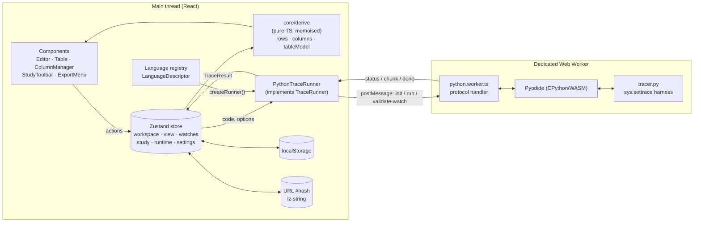
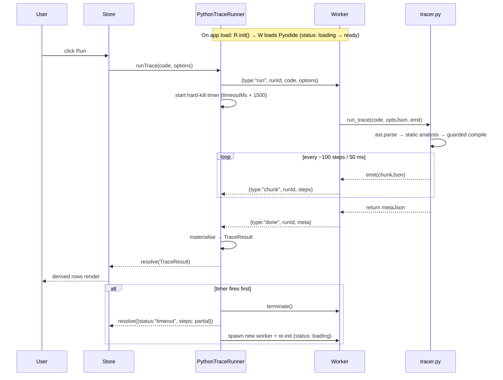

# Trace Table Studio — Architecture & Implementation Plan

> Client-side Python trace-table generator with Study/Quiz mode and multi-format export.
> Stack: React + TypeScript + Vite · Tailwind CSS v4 · CodeMirror 6 · Pyodide in a Web Worker · Zustand · lz-string · html-to-image.

This document is the blueprint to build from. Sections 3–6 are normative (contracts and algorithms), section 8 lists edge cases, section 9 is the build order.
Design claims about `sys.settrace` behaviour were validated with a throwaway prototype on CPython **3.12.15 and 3.13.17** (the versions bundled by Pyodide 0.27.x / 0.28.x). Findings from that prototype are called out with **[verified]**.

---

## 0. Key design decisions (read first)

| # | Decision | Why |
|---|----------|-----|
| D1 | **The worker always records the full, every-line trace.** Granularity, column visibility, "exam blanks" display, and study masking are pure TypeScript projections on the main thread. | Toggling Compact ↔ Every-line, hiding a column, or starting Study Mode is instant and never re-executes code. Only *code, stdin, watches, seed, limits* trigger a re-run. |
| D2 | **Rows record post-state.** A `line` event fires *before* a line runs, so the tracer keeps a "pending line" per frame and finalises it (snapshot + stdout + watches) on the *next* event in that frame. | Trace tables show values *after* each line. **[verified]** this gives correct exam ordering, e.g. in `r = fact(3)` the callee rows appear before the `r = 6` row. |
| D3 | **Language-neutral `Value` model + `TraceStep` contract.** Each language adapter turns its private wire format into the shared types. Everything downstream (table, study, export, share) only knows the shared types. | Adding JS/Java/C++ later is just a new `LanguageDescriptor` + `TraceRunner`. |
| D4 | **Values are serialised to immutable JSON the instant a step is finalised.** No live references cross the boundary. | Solves mutable snapshot aliasing by construction (no `deepcopy`, no PyProxy leaks). |
| D5 | **Python → JS transport is JSON strings, streamed in chunks** (every ~100 steps / 50 ms) via an injected `emit` callback. | Avoids PyProxy lifetime management. Partial traces survive a hard `worker.terminate()`. |
| D6 | **Layered safety:** step limit + soft deadline in the tracer → AST guard against swallowing → `SharedArrayBuffer` interrupt (if cross-origin isolated) → hard `worker.terminate()` + respawn. | `sys.settrace` alone can't stop code blocked in C (`sum(range(10**10))`), and **[verified]** a bare `except:` swallows the abort exception, after which CPython disables tracing permanently. |
| D7 | **`input()` uses pre-supplied stdin. When it runs dry, the run ends with `awaiting-input` and the UI asks, appends, and re-runs deterministically (seeded `random`).** | No blocking worker, no COOP/COEP requirement. Runs are ~milliseconds, so re-running is invisible. |
| D8 | **`runTrace` never rejects for user-code problems.** Syntax errors, exceptions, limits and timeouts all resolve with a `status`. It rejects only if the runtime itself is broken. | One code path in the UI. Partial traces are always renderable. |

---

## 1. Architecture & data flow



### Run sequence



---

## 2. Project structure

```
trace_table/
├─ index.html
├─ package.json · vite.config.ts · tsconfig.json · eslint.config.js
├─ public/
│   └─ _headers                      # COOP/COEP for Netlify/Cloudflare (optional, enables SAB interrupt)
├─ src/
│   ├─ main.tsx · App.tsx
│   ├─ core/                         # framework-free, language-agnostic, 100% unit-tested
│   │   ├─ types.ts                  # Value, TraceStep, TraceResult, TraceOptions, Watch*
│   │   ├─ runner.ts                 # TraceRunner, RunnerStatus, RunnerCapabilities
│   │   ├─ language.ts               # LanguageDescriptor, Preset
│   │   ├─ derive/
│   │   │   ├─ columns.ts            # discover ColumnDefs from TraceResult
│   │   │   ├─ rows.ts               # granularity + visibility → TraceRow[]
│   │   │   └─ tableModel.ts         # TraceRow[] → {headers, cells: string[][]} for exporters
│   │   ├─ study/
│   │   │   ├─ rng.ts                # mulberry32 seeded PRNG
│   │   │   ├─ mask.ts               # mask selection
│   │   │   └─ grade.ts              # answer comparison (uses descriptor.parseAnswer)
│   │   ├─ export/ markdown.ts · csv.ts · latex.ts · json.ts · download.ts
│   │   └─ share/ urlState.ts        # encode/decode + schema versioning
│   ├─ languages/
│   │   ├─ registry.ts               # { python: pythonDescriptor }
│   │   └─ python/
│   │       ├─ descriptor.ts
│   │       ├─ PythonTraceRunner.ts  # worker lifecycle, timers, wire → TraceStep materialisation
│   │       ├─ protocol.ts           # message unions (shared by worker + adapter)
│   │       ├─ python.worker.ts
│   │       ├─ tracer.py             # imported via `?raw`
│   │       ├─ literal.ts            # Python literal parser + formatter (grading & display)
│   │       └─ presets.ts
│   ├─ store/  index.ts · workspaceSlice.ts · runtimeSlice.ts · viewSlice.ts · watchSlice.ts · studySlice.ts · settingsSlice.ts
│   ├─ components/
│   │   ├─ layout/   AppShell · Toolbar · RuntimeStatusBadge · ThemeToggle
│   │   ├─ editor/   CodeEditor · traceHighlight.ts (StateField/Effect) · InputsPanel · PresetPicker
│   │   ├─ table/    TraceTable · TraceCell · ColumnManager · WatchPanel · ErrorBanner
│   │   ├─ study/    StudyToolbar · StudyCell · ScoreSummary
│   │   └─ export/   ExportMenu · ExportTable (static, non-virtualised render for PNG/print)
│   └─ styles/ index.css (Tailwind + @media print)
└─ tests/
    ├─ tracer/  test_tracer.py · conftest.py   # pytest on CPython 3.12 & 3.13 (tracer.py has no Pyodide deps)
    ├─ unit/    *.test.ts                      # vitest: derive, grade, literal, exporters, urlState
    ├─ fixtures/ presets/*.trace.json          # recorded TraceResults (golden files)
    └─ e2e/     *.spec.ts                      # Playwright against real Pyodide
```

`tracer.py` deliberately imports nothing from `js`/`pyodide`. The worker injects the `emit` callback. That lets the whole tracer be tested with plain `pytest` (`uv run --python 3.12 pytest tests/tracer`), which is far faster than testing through a browser.

---

## 3. Core TypeScript interfaces (`src/core/types.ts`, `runner.ts`, `language.ts`)

```ts
// ───────────── Values (language-neutral, immutable, JSON-safe) ─────────────
export type Value =
  | { k: 'none' }
  | { k: 'bool'; v: boolean }
  | { k: 'int'; v: string }                       // string: arbitrary precision, no bigint JSON issues
  | { k: 'float'; v: string }                     // repr(): '0.1', 'inf', 'nan', '3.0'
  | { k: 'str'; v: string; truncated?: number }   // truncated = original length if cut
  | { k: 'list' | 'tuple' | 'set' | 'frozenset'; items: Value[]; ref: number; truncated?: number }
  | { k: 'dict'; entries: [Value, Value][]; ref: number; truncated?: number }
  | { k: 'object'; type: string; fields: Record<string, Value>; ref: number }  // instances with __dict__
  | { k: 'cycle'; ref: number }                   // back-reference → rendered like Python's [...]
  | { k: 'opaque'; type: string; repr: string };  // range, generators, anything else (repr, capped)

// `ref` = per-run stable object identity. Two variables with the same ref alias the same object
// (UI can badge "a ≡ b"). It is NOT id(): ids are re-mapped to small ints so they're stable across runs.

// ───────────── Frames & steps ─────────────
export interface FrameInfo {
  id: number;            // unique per call within a run (0 = module)
  name: string;          // '<module>', 'fact', 'Stack.push'
  depth: number;         // 0 = module
  callLine?: number;     // caller's line that made this call
  argsLabel?: string;    // 'fact(n=3)' — for the call-stack column
}

export interface VarRef { frameId: number; name: string }

export interface ScopeSnapshot {
  frame: FrameInfo;
  vars: Record<string, Value>;   // full state of that frame after this step (structurally shared between steps)
}

export type StepKind = 'call' | 'line' | 'return' | 'exception';

export interface TraceStep {
  stepIndex: number;
  kind: StepKind;
  lineNumber: number;
  lineSource: string;
  frame: FrameInfo;                  // active frame
  callStack: FrameInfo[];            // user frames only, outermost → innermost
  scopes: ScopeSnapshot[];           // every live user frame, same order as callStack
  writes: VarRef[];                  // bound or mutated by this step (value change ∪ static assignment)
  deletes: VarRef[];                 // del x / name leaves scope
  stdoutDelta: string;               // printed during this step (includes echoed input())
  returnValue?: Value;               // only when kind === 'return' and the return is explicit
  exception?: { type: string; message: string; caught: boolean };
  branch?: boolean;                  // if/elif/while/for header: was the body entered?
  watches: Record<string, WatchResult>;
}

// ───────────── Result ─────────────
export type TraceStatus =
  | 'ok' | 'syntax-error' | 'runtime-error' | 'step-limit' | 'timeout'
  | 'awaiting-input' | 'cancelled' | 'internal-error';

export interface TraceError {
  kind: TraceStatus;
  type?: string;                     // 'ZeroDivisionError'
  message: string;                   // user-facing, already friendly
  line?: number; column?: number; endLine?: number; endColumn?: number;
  traceback?: { line: number; functionName: string }[];   // user frames only
}

export interface VariableMeta {
  columnId: ColumnId;                // `${scopeName}:${name}` e.g. 'fact:n', '<module>:total'
  scopeName: string;
  name: string;
  firstStep: number;                 // drives default column order (order of first appearance)
  ephemeral: boolean;                // comprehension targets etc. → hidden by default
}

export interface TraceResult {
  runId: string;
  language: LanguageId;
  status: TraceStatus;
  steps: TraceStep[];
  variables: VariableMeta[];
  functions: string[];               // function scopes seen, for column grouping
  stdout: string;                    // full output
  error?: TraceError;
  inputRequest?: { prompt: string; consumedCount: number };
  stats: { stepsExecuted: number; durationMs: number; truncated: boolean };
  executionKey: string;              // hash(language, code, stdin, watches, seed, limits) — keys study sessions
}

// ───────────── Options & watches ─────────────
export interface WatchExpression {
  id: string;                        // nanoid, stable → column id `watch:${id}`
  expr: string;                      // 'arr[i]', 'len(items)', 'i < n'
  label?: string;
  scope: { kind: 'current' } | { kind: 'function'; name: string } | { kind: 'module' };
  enabled: boolean;
}

export type WatchResult =
  | { ok: true; value: Value }
  | { ok: false; reason: 'not-in-scope' | 'error' | 'rejected'; message: string };

export interface TraceOptions {
  maxSteps: number;                  // raw line events (default 1000, UI range 100–10 000)
  timeoutMs: number;                 // default 3000
  maxCallDepth: number;              // default 100 (WASM stack is smaller than native)
  stdin: string[];                   // one entry per input() call
  watches: WatchExpression[];
  randomSeed: number;                // makes `random` deterministic → re-runs & study sessions reproducible
  valueLimits: { maxItems: number; maxDepth: number; maxStringLength: number }; // 50 / 4 / 200
  showCallables: boolean;            // include functions/classes/modules as variables (default false)
  signal?: AbortSignal;
  onProgress?: (p: { stepsExecuted: number }) => void;
}
// NB: granularity, column visibility, display style are NOT TraceOptions (decision D1).

// ───────────── Runner contract (src/core/runner.ts) ─────────────
export type RunnerStatus =
  | { state: 'uninitialised' }
  | { state: 'loading'; message: string; progress?: number }   // 'Downloading Python runtime… 62%'
  | { state: 'ready' }
  | { state: 'running'; stepsExecuted: number }
  | { state: 'failed'; message: string };                     // runtime itself unusable

export interface RunnerCapabilities {
  watchExpressions: boolean;
  stdin: boolean;
  inputMode: 'rerun' | 'blocking' | 'none';
  hardInterrupt: boolean;            // true when SAB interrupt is available (no reload on cancel)
  branchInfo: boolean;
  returnValues: boolean;
}

export interface TraceRunner {
  readonly language: LanguageId;
  readonly capabilities: RunnerCapabilities;
  getStatus(): RunnerStatus;
  onStatus(listener: (s: RunnerStatus) => void): () => void;   // returns unsubscribe
  init(): Promise<void>;                                        // idempotent
  /** Resolves with a TraceResult for ALL user-code outcomes; rejects only on runtime failure. */
  runTrace(code: string, options: TraceOptions): Promise<TraceResult>;
  validateWatch?(expr: string): Promise<{ ok: true } | { ok: false; message: string }>;
  cancel(): void;
  dispose(): void;
}

// ───────────── Language plug-in (src/core/language.ts) ─────────────
export type LanguageId = 'python' | 'javascript' | 'java' | 'cpp' | 'csharp';

export interface LanguageDescriptor {
  id: LanguageId;
  label: string;
  editorExtension: () => Promise<import('@codemirror/state').Extension>;  // lazy
  createRunner: () => TraceRunner;
  presets: Preset[];
  formatValue(v: Value): string;                    // Python: "[1, 2]", "'hi'", "True", "None"
  parseAnswer(text: string): ParsedAnswer;          // Study Mode: user text → Value | error
  defaultOptions?: Partial<TraceOptions>;
}

export type ParsedAnswer = { ok: true; value: Value } | { ok: false; raw: string };
export interface Preset { id: string; title: string; description: string; code: string; stdin?: string[]; suggestedWatches?: string[] }

// ───────────── Derived view model (src/core/derive) ─────────────
export type ColumnId = string;   // 'line' | 'output' | 'return' | 'stack' | `${scope}:${name}` | `watch:${id}`
export interface ColumnDef { id: ColumnId; header: string; group?: string; kind: 'meta' | 'var' | 'watch' }
export interface Cell { value?: Value; display: string; written: boolean; stale?: boolean }
export interface TraceRow { rowIndex: number; stepIndices: number[]; lineNumber: number; depth: number; cells: Record<ColumnId, Cell> }
```

### Messaging protocol (`src/languages/python/protocol.ts`)

```ts
// Main → Worker
export type ToWorker =
  | { type: 'init'; indexURL: string; interruptBuffer?: SharedArrayBuffer }
  | { type: 'run'; runId: string; code: string; options: WireOptions }       // WireOptions = TraceOptions minus signal/onProgress
  | { type: 'validate-watch'; requestId: string; expr: string };

// Worker → Main
export type FromWorker =
  | { type: 'status'; status: 'loading' | 'ready'; message?: string; progress?: number }
  | { type: 'chunk'; runId: string; steps: WireStep[]; frames: WireFrame[] }  // streamed
  | { type: 'done'; runId: string; meta: WireMeta }                           // status, error, stdout, stats, variables
  | { type: 'watch-validated'; requestId: string; ok: boolean; message?: string }
  | { type: 'fatal'; message: string };                                       // Pyodide failed to load/crashed

// Compact wire step (private to the Python adapter; materialised into TraceStep by the adapter)
export interface WireStep {
  i: number; k: 'c' | 'l' | 'r' | 'x';    // call/line/return/exception
  ln: number; f: number; stk: number[];   // line, frame id, stack of frame ids
  w?: [number, string, Value][];          // writes: frameId, name, new value (delta encoding)
  d?: [number, string][];                 // deletes
  o?: string; r?: Value; x?: { t: string; m: string; c: boolean };
  b?: boolean; wt?: Record<string, WatchResult>;
}
```

Rules:
- Every message carries `runId`. The adapter ignores chunks/done for any run that isn't current, so stale results can't overwrite fresh ones.
- One run at a time per runner. A new `runTrace` cancels the in-flight one.
- **Materialisation:** the adapter applies the deltas to a running `Map<frameId, Record<string, Value>>` and emits `TraceStep.scopes` with structural sharing (an unchanged frame reuses the previous object). Memory stays O(changes), but every step still exposes full state.

---

## 4. Python tracer design (`tracer.py`)

### 4.1 Pipeline per run

```
run_trace(code, opts_json, emit) -> meta_json
 1. ast.parse(code)                → SyntaxError? return {status:'syntax-error', line, col, endLine, endCol, msg}
 2. static analysis (StaticInfo)   → per-line facts (see 4.4)
 3. guard transform (4.6)          → AST with abort re-raise in broad except handlers; lines preserved
 4. compile(tree, "<user>", "exec")
 5. fresh sandbox: globals = {"__name__": "__main__", "__builtins__": patched_builtins}
    patched builtins: input → stdin queue; print untouched (stdout is redirected instead)
    random.seed(seed); sys.setrecursionlimit(base + maxCallDepth); import guard (4.8)
 6. sys.stdout = sys.stderr = StepBuffer();  sys.settrace(tracer.global_trace)
 7. exec(code_obj, globals)   inside try/except TraceAbort / Exception / EOFError(input)
 8. finally: sys.settrace(None); restore stdout/stderr/recursionlimit; finalise all pending frames; flush
 9. return meta (status, error, stats, variables meta, full stdout)
```

### 4.2 Tracer skeleton

```python
USER_FILE = "<user>"
TRANSPARENT = {"<genexpr>", "<lambda>", "<listcomp>", "<dictcomp>", "<setcomp>"}

class TraceAbort(BaseException):          # BaseException: `except Exception` in user code can't catch it
    def __init__(self, reason): self.reason = reason     # 'step-limit' | 'timeout' | 'depth-limit'

class Tracer:
    def __init__(self, opts, static, emit):
        self.opts, self.static, self.emit = opts, static, emit
        self.steps, self.raw_count = [], 0
        self.pending = {}          # frame_key -> lineno awaiting finalisation
        self.frame_ids = {}        # id(frame) -> small stable int   (removed on real return)
        self.last = {}             # (fid, name) -> canonical JSON of last emitted value
        self.refs = RefTable()     # id(obj) -> small stable int, holds strong refs for the run (prevents id reuse)
        self.out = StepBuffer()
        self.deadline = time.monotonic() + opts.timeout_ms / 1000
        self.abort_reason = None

    # Installed with sys.settrace; receives only 'call' events.
    def global_trace(self, frame, event, arg):
        if frame.f_code.co_filename != USER_FILE:
            return None                                   # don't trace stdlib/harness frames at all
        if self.abort_reason: raise TraceAbort(self.abort_reason)
        if frame.f_code.co_name in TRANSPARENT:
            return self.transparent_trace                 # counts steps, emits no rows of its own
        self.on_call(frame)                               # emits a 'call' step: params as writes
        return self.local_trace

    def local_trace(self, frame, event, arg):
        if event == "line":
            self.tick()                                   # step limit + deadline (4.5)
            self.finalise(frame, next_line=frame.f_lineno)    # previous line of THIS frame, post-state
            self.pending[self.fid(frame)] = frame.f_lineno
        elif event == "exception":
            self.note_exception(frame, arg)               # attached to the pending line; caught/uncaught resolved later
        elif event == "return":
            self.finalise(frame, next_line=None, returning=arg)
            self.on_frame_exit(frame)
        return self.local_trace
```

A row's state is always **after** its line, because `finalise` runs on the *next* event in that frame (decision D2).

### 4.3 What `finalise` records

1. **Stdout delta:** `self.out.take()` returns and clears everything written since the last finalise. Output printed by a callee is finalised under the callee's own lines first, so it lands on the right row. **[verified]**
2. **Snapshot + diff (delta encoding):**
   - **Active frame:** serialise all visible locals.
   - **Module globals:** serialise all. They're usually few, and a callee can rebind them via `global`.
   - **Other live user frames (callers):** re-serialise **only names bound to mutable objects** (list/dict/set/instances) and closure cells. Immutable bindings in a suspended frame can't change. **[verified]** without this, `bump(nums)` mutating `nums[0]` inside the callee leaves the caller's `nums` column stale until the caller resumes.
   - A per-step memo `id(obj) → Value` means an object reachable from several names is serialised once per step.
   - Compare each canonical JSON string with `self.last[(fid, name)]`. If it differs → `writes`. Names that disappeared → `deletes`.
3. **Static writes:** also add any name in `static.assigns[line]` that exists in the frame. This covers `found = False` re-assigning an unchanged value. Exam tables expect a row there even though nothing changed.
4. **Return value:** on a `return` event, `arg` is the return value. Set `returnValue` only if `line in static.return_lines` (an explicit `return`). Implicit `None` returns stay blank. If the frame is unwinding from an uncaught exception (an `exception` event with no later `line`), set `kind='exception'` instead.
5. **Branch info:** if the finalised line is an `if`/`elif`/`while`/`for` header, `branch = next_line in static.body_range[line]`. The next line is known at finalise time for free.
6. **Watches:** evaluated here against post-state (4.7).
7. **Call rows:** `on_call` emits `kind='call'` at `co_firstlineno` with the parameters as writes and `argsLabel = "fact(n=3)"`. **[verified]** without this, the parameter shows up as "changed" on the first body line, which is wrong for exam tables.

### 4.4 Static analysis (`StaticInfo`, one AST pass)

| Field | Use |
|-------|-----|
| `assigns: dict[line, set[name]]` | Assign / AugAssign / AnnAssign / For target / With-as / walrus / import / def / class names per line |
| `return_lines: set[line]` | Explicit `return` statements |
| `body_range: dict[header_line, (first, last)]` | Branch outcome for if/elif/while/for |
| `ephemeral: set[name]` | Names bound **only** as comprehension targets → `VariableMeta.ephemeral = True` (hidden by default) |
| `source_lines: list[str]` | `lineSource` |

**[verified]** On 3.12+ (PEP 709), list comprehensions are inlined. Their loop variable appears in the enclosing frame's `f_locals` while the comprehension runs, producing one step per iteration on the same line. Marking it ephemeral hides that column by default, and Compact mode then drops those rows.

### 4.5 Limits & aborts

```python
def tick(self):
    self.raw_count += 1
    if self.raw_count > self.opts.max_steps:        self.abort("step-limit")
    if self.raw_count & 63 == 0 and time.monotonic() > self.deadline: self.abort("timeout")
    if len(self.steps) - self.flushed >= 100 or self.flush_timer_due(): self.flush()

def abort(self, reason):
    self.abort_reason = reason                       # sticky: re-raised at every later call event
    raise TraceAbort(reason)
```

- **Step limit counts raw `line` events**, not table rows. Recommended default: **1000**. A 6-element bubble sort is ~150 line events, so a limit of 500 is tight for Every-line mode. Rows are always ≤ steps.
- **Recursion depth:** `on_call` checks `depth > maxCallDepth` → `abort("depth-limit")` with a friendly message. That's well below the point where the WASM stack overflows, which can corrupt the Pyodide instance.
- **Final status** comes from `self.abort_reason` whether or not the exception escaped (see 4.6).

### 4.6 The "swallowed abort" problem and the guard

**[verified on 3.12 & 3.13]** If user code has a bare `except:` (or `except BaseException`) around the line where the tracer raises, the handler catches `TraceAbort`. CPython then **unsets the trace function**, and the program keeps running **untraced** (the test loop ran all 10⁶ iterations).

Mitigations, in order:
1. **AST guard transform.** For every `ExceptHandler` whose `type` is `None`, `BaseException`, or a tuple containing it, insert `__tt_check__()` as the handler's first statement. `__tt_check__` re-raises `TraceAbort` if `abort_reason` is set. `ast.copy_location` keeps line numbers intact. Same for `try/finally` bodies: `finally` code runs, but the abort continues propagating afterwards.
2. **Sticky status:** even if code somehow continues, the result reports `step-limit`/`timeout` with the partial trace.
3. **Hard backstop:** main-thread timer → SAB interrupt (if available) → `worker.terminate()`. The partial trace was already streamed (D5).

### 4.7 Watch expressions

- **Validation (on add/edit, via `validate-watch`):** `ast.parse(expr, mode="eval")`, then an **allowlist** walk:
  - Allowed nodes: `Name`, `Constant`, `Subscript`, `Slice`, `Attribute` (non-dunder), `BinOp`, `UnaryOp`, `BoolOp`, `Compare`, `IfExp`, `Tuple`/`List`/`Set`/`Dict` literals.
  - Allowed `Call` only for safe builtins `{len, abs, min, max, sum, sorted, round, int, float, str, bool, ord, chr, isinstance, any, all, list, tuple}` and pure methods `{count, index, get, keys, values, items, upper, lower, strip, find, startswith, endswith, isdigit, isalpha, split, join}`.
  - Rejected: lambdas, comprehensions, walrus, `await`/`yield`, dunder access. Messages are friendly: "Watch expressions can't call `pop()` — it would change your program's state."
- **Evaluation (per finalised step):** `eval(compiled, frame.f_globals, dict(frame.f_locals))`. Copying `f_locals` matters on 3.13+, where it's a write-through proxy (PEP 667). Tracing is already suspended inside a trace function, so watches never create steps.
- **Scope:** `current` uses the active frame. `function:fact` uses the innermost live `fact` frame (`not-in-scope` if there isn't one). `module` uses globals. `NameError` → `not-in-scope`, rendered as a muted "–". Other exceptions → `error`, rendered as `⚠` with the message in a tooltip.
- **Cost:** compiled once per run. An expensive-but-allowed watch (`sum(range(10**9))`) is caught by the hard timeout.

### 4.8 Value serialisation

- Check `bool` **before** `int` (bool is an int subclass).
- Floats via `repr`. Ints as strings.
- Containers recurse with a `seen` set to detect cycles → `{k:'cycle'}`. Caps from `valueLimits` add `truncated`.
- Instances with `__dict__` → `object` with fields, capped at depth. Everything else → `opaque` with `repr()` capped at 80 characters and wrapped in try/except, since a user `__repr__` can raise or loop.
- **Hidden by default:** dunder names, modules, functions, classes (`showCallables` toggles these), and the harness's `__tt_check__`.
- **`RefTable`** maps `id(obj)` → small int and keeps a strong ref for the run, so ids can't be recycled and alias badges stay correct.

### 4.9 `input()` and stdin

```python
def patched_input(prompt=""):
    out.write(str(prompt))
    if not stdin_queue:
        raise InputExhausted(prompt)          # BaseException subclass → run ends with status 'awaiting-input'
    value = stdin_queue.pop(0)
    out.write(value + "\n")                   # echo, like a terminal, so the Output column reads naturally
    return value
```
When the UI gets `awaiting-input`, it shows the prompt inline ("Program asked: `Enter a number:`"). The user's answer is appended to the Program Inputs box and the code re-runs. It's deterministic because `random` is seeded and the sandbox is fresh. In "Strict" setting, the UI instead shows the error "Program needs 3 inputs, you supplied 2."

### 4.10 Isolation & security (shared links run someone else's code)

- **Never auto-run code from a share link.** Show it, require a click on Run, and show a banner: "Shared code — review before running".
- **Import guard:** a `sys.meta_path` finder blocks `js`, `pyodide`, `pyodide_js`, `micropip`, `_pyodide` for `<user>` code. Pyodide-bundled stdlib (`math`, `random`, `collections`, …) is allowed.
- **The worker has no DOM or `localStorage` access.** Add a CSP whose `connect-src` is limited to self + the Pyodide CDN, so user code can't call home with `fetch`.
- A fresh globals dict and a copied `__builtins__` per run mean user monkey-patching doesn't leak between runs.

---

## 5. Worker & adapter lifecycle

- **Eager init:** `App` mounts → `registry.python.createRunner().init()`. The status badge shows `Loading Python… (≈10 MB, first visit only)` → `Ready`. First load is ~2–5 s, then it comes from the HTTP cache.
- **Pyodide loading:** module worker `new Worker(new URL('./python.worker.ts', import.meta.url), { type: 'module' })`. Use `loadPyodide({ indexURL: CDN_URL })` with an **exact pinned version** (e.g. `https://cdn.jsdelivr.net/pyodide/v0.28.x/full/`). Load `tracer.py` via `import tracerSrc from './tracer.py?raw'` and `pyodide.runPython(tracerSrc)` once.
- **Timers:** soft deadline in the tracer = `timeoutMs`. Hard kill on the main thread = `timeoutMs + 1500`.
- **Cancel:** with `crossOriginIsolated`, write `2` into the interrupt `Int32Array` (`pyodide.setInterruptBuffer`) → `KeyboardInterrupt` at the next bytecode boundary, no reload. Without it, `terminate()` → status `loading` → respawn.
- **Fatal recovery:** if Pyodide raises `RangeError`/a fatal error, respawn once automatically. If it fails again, set `failed` with a "Reload page" action.
- **COOP/COEP is optional (progressive enhancement).** Set it in `vite.config.ts` `server.headers` and in `public/_headers` for Netlify/Cloudflare Pages. GitHub Pages can't set headers, so either skip it there or use `coi-serviceworker`.

---

## 6. Derivation, display & Study Mode

### 6.1 Columns (`derive/columns.ts`)
- Order: `Line` · variables grouped by scope (module first, then functions in first-call order), each group in first-appearance order · watches · `Return` (if any explicit return) · `Output` · optional `Call stack`.
- **Recursion:** one column per `(function, name)`, e.g. `fact:n`. It shows the value from the **innermost live** frame of that function. Rows are indented by `depth` with a depth rail. The optional `Call stack` column shows `fact(3) › fact(2) › fact(1)`. Stretch goal: a "per-call columns" mode (`n₁ n₂ n₃`) for depth ≤ 5.
- Headers are two rows (scope group ▸ variable) when more than one scope is visible.

### 6.2 Rows (`derive/rows.ts`) — pure function of (TraceResult, granularity, visibleColumns, displayStyle)
- **Every-line:** one row per `call`/`line`/`return`/`exception` step in non-transparent frames. Header lines show the `branch` outcome (e.g. a `while i < n` row with a `True` chip).
- **Compact / Exam (default):** keep step *s* iff any of:
  - `s.writes` hits a visible variable column
  - `s.stdoutDelta` is non-empty and Output is visible
  - `s.returnValue` is set
  - `s.exception` is set
  - a visible watch's value differs from the previous kept row
  - `s.kind === 'call'` and the call shows parameters

  Hiding a column can therefore remove rows. That's intended ("tracked variables").
- **Display style:**
  - *Exam blanks* (default): a cell shows a value only where `written`.
  - *Carry forward*: every cell shows its current value, and written ones are emphasised.

  A variable whose frame has returned shows blank.

### 6.3 Study Mode (`study/*`)
- **Entering Study Mode freezes** `executionKey`, visible columns, granularity and display style for that session, so the answer key can't shift under the user. Editing code shows "Code changed — restart session?".
- **Maskable cells:** only cells that contain something in the current display style (in Exam blanks, the written cells). Blank cells stay blank and aren't graded.
- **Masking modes:** all · random *p*% (seeded `mulberry32`, the seed is stored so Reset/share reproduce it) · selected columns. Options: never mask the `Line` column, and "mask Output only".
- **Interaction:** masked cells become `<input>`s with `aria-label="Row 4, total"`. Enter/↓ moves down the column, Tab moves across. Focusing or clicking a row highlights its line in the editor.
- **Grading (`grade.ts`)**, three states — ✅ correct · 🟡 close · ❌ incorrect:
  1. Normalise: trim, unify `\r\n`, collapse whitespace outside string literals.
  2. `descriptor.parseAnswer(text)`. The Python literal parser in `literal.ts` is a small recursive-descent `ast.literal_eval` clone: ints, floats, `True/False/None`, `'…'`/`"…"` with escapes, lists, tuples (incl. `(1,)`), dicts, sets.
  3. Structural compare with ground truth:
     - quote style ignored (`'hi'` ≡ `"hi"`)
     - list spacing ignored
     - dict/set order ignored (dicts compare like Python `==`)
     - floats: `Number(a) === Number(b)` or relative error < 1e-9
  4. **Close** (amber, counts half or zero, configurable) for classic exam slips. The feedback names the slip:
     - `3` vs `3.0` — int vs float, e.g. `/` vs `//`
     - unquoted `hi` for a str
     - `true` for `True`
     - `[1,2]` vs `(1, 2)`
  5. Output cells: compare line by line after trimming trailing whitespace.
  6. Unparseable input falls back to a normalised string compare against `formatValue(truth)`.
- **Feedback:** "Check Answers" → green/red/amber cells plus a score (`17 / 20 · 85%`, with a per-column breakdown). Per-cell actions are **Hint** (type and length, e.g. "a list of 4 ints") and **Reveal** (marked revealed, excluded from the score). Answers persist to `localStorage` keyed by `executionKey` (the 5 most recent sessions).

---

## 7. Editor, presets, persistence, export

### 7.1 Editor
- `@uiw/react-codemirror` + `@codemirror/lang-python` + `@codemirror/lint`.
- A custom `traceHighlight` extension (`StateField<DecorationSet>` + `StateEffect<number | null>`) gives the hovered row a soft line decoration and the selected row a strong decoration plus a gutter arrow. It scrolls into view.
- Syntax/runtime errors go in via `setDiagnostics` (red squiggle at `line:col`).
- Editing after a run marks the trace **stale** (dimmed table, "Re-run" button). Optional auto-run (debounced 800 ms) setting.

### 7.2 Presets (`languages/python/presets.ts`)
1. **Linear search** — `while` + `found` flag, early exit.
2. **Bubble sort** — nested loops, swap via tuple assignment, `swapped` flag.
3. **Digit sum / reverse a number** — `while n > 0`, `%` and `//`.
4. **2D list traversal** — row totals of a matrix, nested `for` with `range(len(...))`.
5. **Recursive factorial / sum of list** — call rows, depth, return values.
6. **Vowel counter with `input()`** — stdin box pre-filled, string iteration, `print` output.

Each preset has a golden-file test (`tests/fixtures/presets/*.trace.json`) so tracer regressions show up as diffs.

### 7.3 Persistence & sharing
- Zustand `persist` (key `tts:v1`, `version` + `migrate`). Persisted: workspace (code, language, stdin), view (granularity, hidden columns, display style, column order), watches, settings (theme, limits), and study answers by `executionKey`. **Not** persisted: `TraceResult`. On load it re-runs once the runner is ready, which is cheap and deterministic.
- **Share link:** `#s=` + `LZString.compressToEncodedURIComponent(JSON.stringify(ShareStateV1))`.
  - `ShareStateV1 = { v:1, lang, code, stdin, granularity, hidden: ColumnId[], watches, seed, display, study?: { maskMode, pct, columns, maskSeed } }`.
  - Column ids are `scope:name`, so they're stable across runs.
  - Warn if the URL is over 8 000 chars (chat apps truncate).
  - On open: load into a "Shared workspace" banner (**Keep** / **Discard**). Never silently overwrite the local workspace. Then `history.replaceState` removes the hash. No auto-run (4.10).

### 7.4 Exports — all read the **same `TableModel`** (`derive/tableModel.ts`)
`TableModel = { title, columns: { id, header, group? }[], rows: string[][], note? }`. It's built from the visible columns, the current granularity and display style, and the export variant: **Answer key** (truth) or **Worksheet** (masked cells blank, useful for teachers).

| Format | Details |
|--------|---------|
| Markdown | GFM table. Escape `\|`, newlines → `<br>`. Copy button + `.md` download. |
| CSV | RFC 4180 quoting, `\r\n` line endings, UTF-8 **BOM** so Excel opens accents correctly. |
| LaTeX | `booktabs` (`\toprule/\midrule/\bottomrule`), values in `\texttt{}`, escape `\ { } $ & # ^ _ % ~`. Options: `longtable` for > 40 rows, `\cmidrule` group headers. Includes a `% requires \usepackage{booktabs}` comment. |
| JSON | `{ schema: "trace-table/v1", source: {code, stdin, language}, view: {...}, result: TraceResult }`. Full fidelity, can be re-imported later. |
| PNG | `html-to-image` `toPng(node, { pixelRatio: 3, backgroundColor })` on a hidden **`ExportTable`**: static, non-virtualised, no inputs or sticky headers, theme-aware. Self-host fonts (`@fontsource/*`) so embedding doesn't hit CORS. |
| Print / PDF | `@media print`: hide everything except `.print-region`; `thead { display: table-header-group }` (repeats on every page); `tr { break-inside: avoid }`; force light palette; `print-color-adjust: exact` keeps study colours. |

All downloads go through `download.ts` (`Blob` + `URL.createObjectURL` + revoke).

### 7.5 UI notes
- Layout: editor (left) · table (right), stacking on narrow screens. Toolbar: Language · Presets · Run (⌘/Ctrl-Enter) · Granularity segmented control · Study toggle · Export · Share · Theme.
- Tailwind v4 (`@tailwindcss/vite`), class-based dark mode, monospaced cells, high contrast. Status colours never rely on colour alone: icons plus `aria` text.
- Tables over ~300 rows virtualise with `@tanstack/react-virtual`. Export and print always use the full static table.

---

## 8. Edge cases & mitigations

| Edge case | Mitigation |
|-----------|------------|
| Mutable objects changing after snapshot | Serialised to immutable `Value` at finalise time (D4); nothing references live objects. |
| Callee mutates caller's list (aliasing) | Re-serialise mutable bindings in all live frames each step (4.3). `ref` ids let the UI badge aliases. **[verified issue]** |
| Same value re-assigned (`found = False` again) | Static `assigns` per line → still a write → still a row in Compact mode. |
| Recursion display | `fact:n` shows the innermost frame; depth indentation; call rows `fact(n=2)`; Return column; optional Call-stack column; `maxCallDepth` abort. |
| Comprehension variables (3.12+ inlining) | Marked `ephemeral` → hidden by default → Compact mode drops their rows. `<genexpr>`/`<lambda>` frames are transparent. **[verified issue]** |
| Generators (`yield`) | `yield` fires `return`, resume fires `call` with the same frame. Keep `frame_ids` for frames whose `co_flags & CO_GENERATOR` until truly finished. Shown as `gen.next()` rows. |
| Bare `except:` swallowing abort | AST guard (4.6) + sticky status + hard kill. **[verified issue]** |
| Code blocked in C (`time.sleep`, giant `sum(range())`) | Main-thread hard kill → partial streamed trace + `timeout` status. |
| User calls `sys.settrace(None)` | Same as above: untraced → hard kill backstop. Documented, not prevented. |
| Multi-line statements | `line` events fire on the statement's first line. `lineSource` shows the full statement span (from the AST `lineno..end_lineno`). |
| Several statements on one line (`a = 1; b = 2`) | One row, both writes. Correct exam behaviour. |
| Huge values (`list(range(10**6))`) | `maxItems`/`maxDepth`/`maxStringLength` caps with `truncated` → rendered `[0, 1, 2, … +999 997]`. |
| `print(..., end="")` / partial lines | Output cell shows the raw delta with a `⏎` marker for newlines. Grading normalises trailing whitespace only. |
| Floats (`0.1 + 0.2`) | Displayed as Python `repr` (`0.30000000000000004`, what the exam board expects). Grading tolerance 1e-9 relative. |
| `int` vs `float` (`6/2` → `3.0`) | Graded **close** with an explanation. This is a key teaching moment. |
| String quoting in answers | Either quote style is correct. Unquoted is **close** (configurable to correct for lenient teachers). |
| Non-determinism (`random`, `time`) | `random.seed(seed)`. The seed is in the share link and `executionKey`. `time` is left alone and documented. |
| Stale worker results | `runId` checks; latest run wins. |
| Pyodide fails to load (offline, CSP) | `fatal` → status `failed` with retry. The editor, presets and previously exported JSON still work. |

---

## 9. Phased implementation plan

Each milestone ends in a working, demoable app plus tests. Estimates assume one developer working part-time.

### M0 — Scaffold (½ day)
- Vite React-TS, Tailwind v4, ESLint/Prettier, Vitest, Playwright, folder skeleton, `core/types.ts` and `runner.ts` exactly as in §3.
- `FakeTraceRunner` that replays fixture JSON. This proves the UI is runner-agnostic from day one and powers UI tests without Pyodide.
- **Exit:** `npm run dev`, `npm test` and `uv run --python 3.12 pytest` all green on empty suites.

### M1 — Vertical slice: code → trace → table (2–3 days)
- `tracer.py` v1: compile/syntax errors, global/local trace split, pending-line post-state, globals + current-frame snapshot, stdout per step, step limit, `TraceAbort`. **pytest** for while-loop, syntax error and infinite loop.
- Worker + protocol (`init`/`run`/`done`/`status`), `PythonTraceRunner` (no streaming yet), status badge.
- CodeMirror editor, Run button, **Every-line** table (Line · variables · Output) in carry-forward style. Error banner.
- **Exit:** the digit-sum program renders the correct table, `while True: pass` shows a step-limit error, and the UI stays responsive (Playwright test).

### M2 — Trace fidelity & safety (3–4 days)
- Frames & scopes: call rows, return values, deltas across all live frames, `ref` aliasing, recursion columns, depth limit.
- Static analysis: `assigns`, `return_lines`, `body_range` (branch info), `ephemeral`. AST except-guard.
- **Compact/Exam granularity** + Exam-blanks display (`derive/rows.ts`, heavily unit-tested).
- Streaming chunks, soft deadline, hard-kill + respawn, optional SAB interrupt.
- `input()` with stdin box + `awaiting-input` re-run flow. Seeded `random`.
- Row ↔ editor highlight sync. The 6 presets with golden fixtures.
- **Exit:** all 6 presets match hand-checked exam tables. Bare-except loop, `time.sleep(10)` and deep recursion each end with the right status and a partial trace.

### M3 — Column Manager, watches, persistence, sharing (2–3 days)
- Column Manager popover: show/hide/reorder, Line/Output/Return/Call-stack toggles, "show ephemeral", "show functions".
- Watch panel: add/edit/remove, `validate-watch`, scope selector, results as columns.
- Zustand `persist` + migrations. Share link encode/decode + "Shared workspace" banner.
- **Exit:** reload restores everything. A share link reproduces the same table in a fresh profile. `arr.pop()` is rejected with a helpful message.

### M4 — Study Mode (3 days)
- `literal.ts` parser + `formatValue` (property-style tests: `parse(format(v)) ≡ v`).
- Masking modes with seeded RNG, study cells with keyboard navigation, Check Answers, three-state grading with explanations, score summary, hint/reveal, session persistence by `executionKey`.
- **Exit:** a grading test table covering `'hi'`/`"hi"`, `3`/`3.0`, `[1,2]`/`[1, 2]`, `True`/`true`, dict order and output lines. A full keyboard-only quiz run in Playwright.

### M5 — Export suite & polish (2–3 days)
- `TableModel` + Markdown/CSV/LaTeX/JSON exporters (snapshot-tested; LaTeX compiled once in CI with `tectonic` if convenient). Answer-key vs worksheet variants.
- PNG via `ExportTable`, print stylesheet.
- Dark/light polish, accessibility pass (axe in Playwright), virtualisation for long traces, empty/first-visit states, deploy (Netlify/Cloudflare Pages with `_headers` for COOP/COEP + CSP).
- **Exit:** each export opens correctly in its target (GFM preview, Excel, Overleaf, image viewer, print preview). Lighthouse a11y ≥ 95.

### Later — proving the adapter pattern
- **JavaScript runner:** a separate worker that instruments code with an Acorn/Babel AST transform (inserting `__step(line, () => ({…locals}))` calls). It reuses everything downstream unchanged.
- **Java / C++ / C#:** a `RemoteTraceRunner` against a backend (Piston/Judge0 can't trace, so a JDI/GDB-based tracer service would emit the same `TraceStep` JSON). The UI's only change is the registry entry.

---

## 10. Testing strategy (summary)

| Layer | Tool | What |
|-------|------|------|
| Tracer | pytest on CPython 3.12 + 3.13 (matrix) | Every edge case in §8 as a test. Golden JSON for presets. |
| Core TS | Vitest | `rows.ts` granularity rules, `grade.ts`, `literal.ts`, exporters (snapshots), `urlState` round-trips + old-version migration |
| UI | Vitest + Testing Library + `FakeTraceRunner` | Column Manager, Study interactions, stale-trace banner |
| E2E | Playwright (real Pyodide) | Run preset → table; infinite loop → recover; share link round-trip; study quiz; downloads |

---

## 11. M1 implementation notes (deviations from the plan above)

Built and verified in a real browser (Pyodide in the worker, hostile programs included). What differs from the original design:

| Topic | Plan said | What was built / learned |
|-------|-----------|--------------------------|
| Python version | Pyodide ships 3.12/3.13 | The `pyodide` npm package `314.0.8` bundles **Python 3.14.2**. Tracer tests run on 3.12, 3.13 and 3.14. |
| Pyodide loading | bundle `pyodide` npm module | The worker `import()`s `pyodide.mjs` from the **pinned jsDelivr build** (`PYODIDE_VERSION` in `protocol.ts`, unit-tested to equal the npm package version). No bundler involvement; loads fine under COOP/COEP. |
| Pulled forward from M2 | — | AST abort guard (verified: bare `except:` no longer defeats the step limit in real Pyodide), call rows, return values, `input()` / `awaiting-input`, import guard, class bodies/lambdas/genexprs as transparent frames, call-depth limit, hard-kill + respawn. |
| Still M2 | — | Streaming (a hard-killed run currently loses its partial trace), re-serialising mutable bindings in suspended caller *function* frames (globals already work), static assignment info (re-assigning an unchanged value), comprehension `ephemeral` flag, branch info, Compact/Exam granularity, SAB interrupt, editor↔row highlighting, remaining presets. |
| `LanguageDescriptor.parseAnswer` | required | Optional: absent ⇒ Study Mode unavailable for that language. |
| Row rendering | virtualise > ~300 rows | Not yet: 1000 rows render in roughly 0.6-0.8 s. Planned for M5. |
| Bundle | — | Main chunk ~640 kB (CodeMirror); worker 22 kB. Fine for now; split later if needed. |
| Windows | — | Application Control blocks executables inside a project `.venv`; run Python tooling via `uv run --no-project --with pytest ...` (see CLAUDE.md). |

Measured in-browser: infinite loop → `step-limit` in ~0.6 s; `time.sleep(60)` and `sum(range(10**10))` (blocked in C) → hard-killed at timeout + 1.5 s, runtime respawned, next run fine; main-thread stall during both ≤ ~120 ms.


---

## 12. M2 implementation notes (deviations from the plan above)

Verified in a real browser (Pyodide, Python 3.14): all six presets render tables identical, cell for cell, to hand-checked golden files; hostile programs end with the right status and a partial trace.

| Topic | Plan said | What was built / learned |
|-------|-----------|--------------------------|
| Streaming | flush every ~100 steps / 50 ms | **Every finished row is flushed immediately.** A row is complete once the next line starts, so everything before the *currently executing* line has already been delivered. With batching, rows finished just before a blocking call (`time.sleep`, `sum(range(10**10))`) were lost when the worker was killed. Cost is about 50 µs/row; the UI throttles progress reports to 10/s. Each chunk also carries the executing line, so a killed run reports where it was stuck. |
| SAB interrupt | optional, in M2 | **Deferred.** Streaming already preserves the partial trace on a kill, so the interrupt would only save the ~2.5 s runtime restart on Cancel. |
| `for` targets | static write on the header line | Only when the body is entered. An exhausting loop test does not rebind its target; treating it as a write showed a spurious `j 2` on every loop exit. Found by reviewing the golden tables by hand. |
| Presets | `presets.ts` | `presets/*.py` + `presets.json` manifest, shared by the app (`import.meta.glob ?raw`) and the Python fixture generator, plus a freshness test (fixture code must equal the shipped preset). |
| Editor diagnostics | `setDiagnostics` | Also needs `linter(null)` as a static extension, otherwise @uiw/react-codemirror's reconfigure silently discards the lint state. |
| Caller-frame mutation | re-serialise mutable bindings of live frames | Done: globals are re-snapshotted on every callee row, and suspended caller *function* frames re-serialise only their mutable bindings. |
| Branch info | `branch` on header steps | Done via static body ranges + the next line event. Inline bodies (`if x: y`) and conditions that raise report none. |
| Generators | keep the frame id across resumes | **Not done**: each resume is a separate call row. Tracing works (tested) but is noisy. |
| Multi-line statements | `lineSource` spans the whole statement | Not done; `lineSource` is the first line only. |
| Alias badges (`a ≡ b`) | `ref` ids in the UI | Refs are in the data; no UI yet. |

Test counts at the end of M2: 68 tracer tests (each on Python 3.12, 3.13, 3.14) and 107 unit tests.
